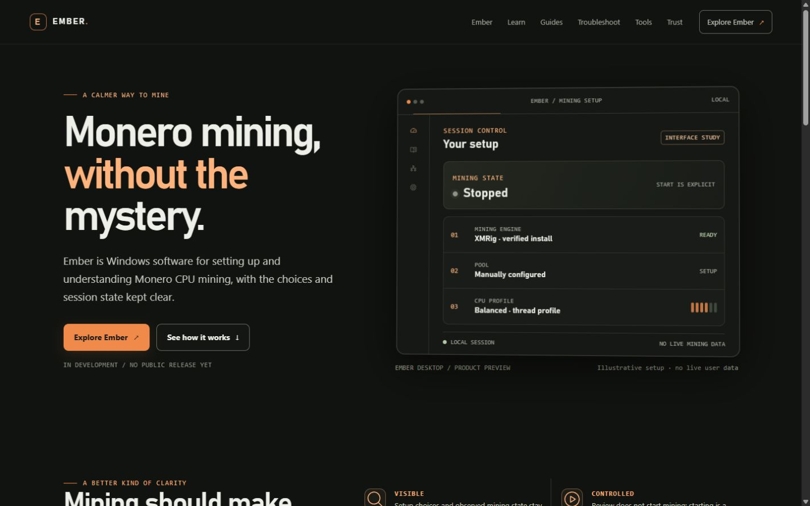
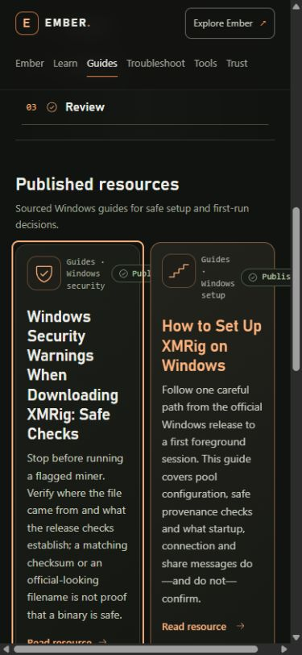

# M12B.0 — Verified preview and implementation baseline

**Date:** 18 November 2026. **Scope:** `website/` only. **Result:** a verified current-build loopback preview is available; controlled CSS viewport testing works. **M12B.1 has not started.** No hub, article, tool, model, parser, dependency or production-network change was made.

## 1. Repository and preservation baseline

- Branch: `main`.
- HEAD: `d3079d1bcb2ecf1630a4d9401e9247a7ba20e064`, newer than M12A's `5c37ccdc4f96075ced30e845640b110633bf6bb2`.
- Initial `git status --short` and `git status --porcelain=v1` were empty: **clean working tree**, including generated files. The four generated modifications recorded by M12A were therefore not presumed to remain.
- All four approved M12A reports were read. The [prioritized plan](m12a-prioritized-improvement-plan.md) remains the implementation scope; this task performs Phase 0 only.
- Before checks/build, saved a durable, rereadable workspace snapshot of all eight tracked `website/.astro` files. At cleanup, their SHA-256 values were **all identical to the initial bytes**; no restoration or Git reset was needed. Temporary audit files were removed after verification. The newly generated audit `preview.json` was removed; the verified static preview process does not depend on that metadata file.
- Verified all 55 source/configuration/manifest/public files used by the build remained byte-identical. No desktop source was edited, no dependencies installed, and no branch, commit, push, PR or deployment was created.

## 2. Available methods and toolchain

| Method | Observed capability / limit |
| --- | --- |
| Restricted command execution | Node can report a loopback listener but its own IPv4/IPv6 HTTP requests fail with `EACCES`. Process/port visibility in this context is insufficient to identify the host listener reliably. |
| Host command execution, approved outside the command sandbox | Native process and TCP ownership inspection; independent HTTP; Node minimal server and Astro preview accessible over loopback. No administrator launch or security-setting change was required. |
| Opera GX extension browser | Running executable product/file version **139.0.6053.63**, from `C:\Users\trigg\AppData\Local\Programs\Opera GX\opera.exe`. Supports DOM inspection, interaction and explicit CSS viewport overrides. Used for the 119-case geometry sweep. |
| ChatGPT in-app browser | Reaches the same native preview; supports DOM inspection, keyboard/locators, viewport overrides and useful JPEG screenshots. Used for retained screenshots, 34 corroborating render measurements and 25 interaction records. Its engine version was not exposed by the supported DOM inspection API; no engine version is invented. |
| Browser limitations | Both available browser methods use Chromium-family rendering; no Firefox/WebKit or physical mobile-device result is claimed. Opera's screenshot path was unreliable under viewport override; see capture notes below. |

Node: **v24.21.0**, executable `C:\Program Files\nodejs\node.exe`. npm: **11.19.0**. Installed Astro: **7.3.5**. Build and preview both used `C:\Users\trigg\Documents\GitHub\tray-xmr\website` and the installed website dependencies.

Existing commands remain unchanged: `npm test`, `npm run check`, `npm run build`, `npm run check:links`, `npm run verify:production-origin`, `npm run preview`, and `npm run dev`. `check:links` already performs a build.

## 3. Connectivity investigation and cause

A dependency-free diagnostic Node server was created temporarily under `website/.m12b0-runtime/`. It served only a unique synthetic audit marker, with no user data or application functionality. The same script/Node installation/cwd was run first inside the command sandbox, then in host execution. Each listener used an explicit address/port and exclusive binding.

| Experiment | Binding / process | Independent observation |
| --- | --- | --- |
| Minimal server in restricted execution | PID **32100**, IPv4 `127.0.0.1:4347`; IPv6 `[::1]:4348` | Both listeners reported ready. Requests from that same process failed with `fetch failed`, cause **`EACCES`**. Host HTTP requests timed out after 5 seconds; Opera navigation timed out. Astro was not involved. |
| Identical minimal server in host execution | PID **6188**, same two bindings | Own requests and independent host HTTP returned **200** on both address families, with the exact marker `ember-m12b0-minimal-d3079d1-20261118`. Opera rendered that marker. TCP ownership inspection identified PID 6188 on both ports. |
| Fresh Astro preview in host execution | PID **29540**, IPv4 **`127.0.0.1:4350`** | Independent HTTP matched every generated file's SHA-256. Opera and the in-app browser rendered the expected homepage and its synthetic-origin metadata/hashed stylesheet. |

**Supported diagnosis:** the restricted execution context causes the reproduced loopback failure. Moving the same diagnostic process into host execution restored both IPv4 and IPv6 connectivity. This resolves the operational preview restriction without changing website source. It is not evidence that Astro or the website is broken.

**Remaining uncertainty:** the exact low-level AppContainer/WFP/security-policy rule was not traced. Historical M12A failures were not separately instrumented, so this is a demonstrated explanation for the current reproduction, not a retroactive packet trace of M12A. A read-only firewall-profile query showed Domain, Private and Public profiles enabled; no profile, rule, exclusion, security protection or production networking was changed. No LAN/public binding or tunnel was introduced.

Build and native preview operated in different **execution contexts**, but the same workspace/build files were visible to both. Matching 31 HTTP response hashes against the fresh disk manifest demonstrates this directly. The browser is connected to the host environment: it displayed the unique native diagnostic marker and the verified preview. No older listener was substituted.

The diagnostic servers were stopped after use. The static website preview is left running as the M12B.0 review surface. PIDs are this run's evidence, not stable identifiers for future sessions. The browser viewport overrides were reset and the verified homepage tab retained.

## 4. Build and served-output identity

The release-origin contract remains unchanged. Used **`https://ember-m12b0-audit.invalid`**, an explicitly synthetic HTTPS origin for generated metadata only. It was never deployed; the usable preview address is HTTP loopback.

From `website/`, in PowerShell:

```powershell
$env:SITE_URL = 'https://ember-m12b0-audit.invalid'
npm run check:links
npm run verify:production-origin
```

`check:links` ran the single release-style build and existing content verifier. Build completed successfully with **17 static HTML routes**, nine generated `_astro` assets and five other files, including sitemap, robots and public assets. There were no unexpected HTML routes.

| Identity | Value |
| --- | --- |
| Source aggregate, 55 files | `a2969abf75f2d3ae362b7e9833f6c08dd31c9b865f328056aa384aaa73a7892a` |
| Generated-output aggregate | `44163e169e9c40386858d1ceebdb7c8d8a2d9cb877f708f3c7effdec9f791dd4` |
| Homepage file and HTTP SHA-256 | `8c57c2494f7fa7ab5801b6b9b8eba69c76320864635104746493b93110a851d7` |
| Observed homepage stylesheet | `/_astro/SiteLayout.kgp28hEY.css` |
| Stylesheet file and HTTP SHA-256 | `36417fdf7a8b76ebe7fcafb44448f68f72b03788560316e42d97edb20193e9bc` |

The source aggregate hashes a sorted list of `[relative path, SHA-256]` records for tracked source/public/configuration/manifests. The output aggregate hashes sorted `{path, sha256, bytes}` records for all generated files. These are audit identities, not signatures or a claim of byte-for-byte reproducibility across other toolchains.

[Build identity](evidence/m12b0/build-identity.json) records commit, tool versions, origin, timestamp, article draft flags, all routes and generated-file hashes. [HTTP identity](evidence/m12b0/http-identity.json) records **31/31 responses: HTTP 200 and exact disk-hash match**. Browser DOM independently showed the homepage canonical `https://ember-m12b0-audit.invalid/` and the same hashed stylesheet. Startup output alone was not treated as identity verification.

Preview command, run in host execution:

```powershell
npm run preview -- --host 127.0.0.1 --port 4350 --strictPort
```

Astro reported ready in 48 ms. Host TCP inspection identified **PID 29540**, parent **13100**, running the repository's installed `astro/bin/astro.mjs preview --host 127.0.0.1 --port 4350 --strictPort`, bound only to IPv4 loopback. Use the exact IPv4 URL; `localhost` may resolve to IPv6, while this website preview intentionally has no IPv6 listener.

### Route inventory

| Fixed pages (10) | Published articles (7) |
| --- | --- |
| `/` | `/learn/randomx-memory-cache/` |
| `/ember/` | `/learn/xmrig-cpu-threads/` |
| `/learn/` | `/guides/xmrig-windows-setup/` |
| `/guides/` | `/guides/xmrig-windows-security-warnings/` |
| `/troubleshoot/` | `/troubleshoot/xmrig-huge-pages/` |
| `/tools/` | `/troubleshoot/xmrig-msr-error/` |
| `/trust/` | `/troubleshoot/xmrig-low-hashrate/` |
| `/tools/electricity-cost-calculator/` | |
| `/tools/monero-mining-profitability-calculator/` | |
| `/tools/xmrig-log-decoder/` | |

Sitemap and robots were present and passed the existing origin verifier. All seven article files currently have `draft:false`; collection routes, hubs, related entries and sitemap retain their existing `!data.draft` filters. No draft article was introduced to test hypothetical exclusion behavior, and no filter was changed.

## 5. Controlled CSS viewport baseline

Explicit browser viewport overrides were applied and dimensions read from **`window.innerWidth` / `window.innerHeight`** for every rendered route. Neither JPEG resolution nor browser outer-window size was substituted. Scrollbar-excluding root `clientWidth` is recorded separately in the evidence.

| Requested size | Browser-reported CSS size | Routes rendered / measured | Document-width finding |
| --- | --- | ---: | --- |
| 1440 × 900 | 1440 × 900 | 17 | No document-level horizontal overflow detected. |
| 1280 × 800 | 1280 × 800 | 17 | No document-level horizontal overflow detected. |
| 1024 × 768 | 1024 × 768 | 17 | No document-level horizontal overflow detected. |
| 768 × 900 | 768 × 900 | 17 | No document-level horizontal overflow detected. |
| 600 × 800 | 600 × 800 | 17 | No document-level horizontal overflow detected. |
| 390 × 844 | 390 × 844 | 17 | **Guides overflow:** root client width 375px, scroll width 403px. Other 16 routes did not show document overflow in this sweep. |
| 360 × 800 | 360 × 800 | 17 | **Guides overflow:** root client width 345px, scroll width 388px. Other 16 routes did not show document overflow in this sweep. |

Total: **119 route/viewport measurements**, in Opera. Each recorded one H1 and the expected synthetic-origin canonical. The in-app browser separately corroborated all 17 routes at 1440 × 900 and 390 × 844, including the Guides overflow at 390px. Main-navigation scroll width did not exceed its client width in the sweep.

This is a rendered baseline and bounded geometry check, **not whole-site responsive acceptance**: initial/empty tool states were used for the 119-case sweep; dynamic states were exercised separately. Long-page content was not exhaustively inspected at every size. Hover, all keyboard paths, touch, zoom, assistive technology and physical mobile devices are not covered by the geometry numbers.

### Visible composition observations

- Homepage hero/illustrative setup remains distinctive and legible in reviewed desktop/mobile captures. The development label is visible; there is no public-download CTA.
- At 1440 × 900, the first resource card starts approximately **963px** down Learn, **952px** down Guides, **963px** down Troubleshoot and **1098px** down Tools, measured at initial scroll position. This confirms M12A's concern that usable hub resources follow the first screen at this size; it does not establish abandonment or conversion impact.
- The electricity workspace starts within the reviewed desktop first screen. Profitability's initial result panel starts around **575px** at 1440px width, **1457px** at 768px and **2152px** at 390px. Its mobile projection text computes to **9px** at 600/390/360px. These are existing composition/readability concerns, not calculation failures.
- Setup/security article headings, summaries, dates and introductory visuals occupy much of the mobile opening. Source citations and existing safety boundaries remain present; no content restructuring occurred.

## 6. Screenshot and machine-readable evidence

Evidence directory: [`docs/evidence/m12b0/`](evidence/m12b0/).

- [Screenshot inventory](evidence/m12b0/screenshots.json): **43 JPEGs**, approximately **2.41 MiB** total, with exact filenames, routes, states, browser-reported CSS dimensions, JPEG dimensions, sizes and SHA-256 values.
- **34 initial-state captures:** every route at 1440 × 900 and 390 × 844. This includes all 13 requested representative pages and the four remaining concept/diagnostic articles.
- **Nine interaction/detail captures:** skip focus, mobile main-content keyboard focus, Guides card overflow, mobile setup anchor, focused/scrolled Huge Pages table, electricity valid state, profitability valid desktop/mobile states and decoder synthetic results.
- [Render matrix](evidence/m12b0/render-matrix.json): the 119 Opera cases, including document/nav/table geometry and initial result positions.
- [In-app corroboration](evidence/m12b0/iab-render-checks.json): 34 route/size cases.
- [Interaction records](evidence/m12b0/interaction-checks.json): 25 representative interaction observations. Immediate intermediate smooth-scroll reads were superseded by settled checks; see keyboard notes below.
- [Browser summary](evidence/m12b0/browser-summary.json): methods, viewport cleanup and capture limitations.
- Build/HTTP identity manifests described above.

Representative evidence:





**Capture limitations:** Opera's viewport override changed CSS dimensions correctly, but screenshot output could be scaled/letterboxed; a full-page capture also timed out. Retained regular captures were replaced with in-app captures. An initial in-app desktop capture used stale compositor bounds immediately after resize and was replaced after allowing resize/paint to settle. Retained JPEG dimensions may still be scaled relative to CSS dimensions; the inventory records both. The faulty/duplicate exploratory images were removed. Screenshots capture specific states, not every pixel of every long page. No screenshots were committed.

## 7. Existing UI issues — separate from future regressions

These were observed **before M12B.1**, with source untouched. All are P2 baseline issues/meaningful improvements unless future evidence establishes greater severity.

| ID | Confirmed baseline observation | Evidence / likely implementation target |
| --- | --- | --- |
| UI-01 | Guides published cards remain two columns on mobile. At 390px, computed columns are `161px 161px`; the Published badge reaches x≈403px, creating page overflow. Also reproduced at 360px. | Screenshot above; render matrix. `site.css`: `.hub-published .hub-grid` retains two columns; the ≤680px selector list has specific Learn/Troubleshoot/Tools overrides but no equivalent Guides override. **M12B.1 hub scope.** M12A's generic mobile-stacking prediction was incomplete; this is new rendered evidence. |
| UI-02 | Mobile setup section link partly obscures the target heading under the wrapped sticky header. Settled Configure target starts y≈100px; header ends y=116px. Desktop target y≈100px clears the 79px header. | `setup-anchor-390x844.jpg`; interaction records. Existing global 100px anchor clearance does not match the mobile header. Track for the article/navigation phase; preserve awareness during shared-shell changes. |
| UI-03 | Entering only profitability hashrate immediately marks **seven untouched required fields** invalid with “Enter a value.” | Interaction record. Existing controller policy; no live-region announcement burden was measured with a screen reader. Keep for the approved tool phase. |
| UI-04 | Electricity pence/USD mismatch clears cost but leaves old power/energy readouts after watts are changed: input 200 W, displayed 100 W and 2.4 kWh/day. The status correctly says to choose GBP or a compatible rate unit. | Reproduced sequence: valid/default power → enter rate → choose pence → USD → change power to 200. Controller returns before refreshing energy readouts. **UI stale-state issue, not a mathematical model defect.** |
| UI-05 | Decoder textarea computes to Segoe UI/Arial rather than the intended mono stack. | Rendered computed style and source: undefined `--font-mono`; shared token is `--mono`. No token fix made. |
| UI-06 | Hub cards are below the 900px first screen and tool cards still say “Read resource.” | Initial screenshots/positions. Existing discovery/composition issue directly relevant to M12B.1; no claim of measured user harm or search loss. |
| UI-07 | Profitability mobile result access follows the long form and detailed projections use 9px text. | Render matrix and `profitability-valid-390x844.jpg`. Tool-layout phase candidate; no result-value error observed in the tested scenario. |

No new UI defect was introduced by M12B.0. None of these issues was fixed in this preparation milestone.

## 8. Keyboard and interaction baseline

| Check | Observed result / limits |
| --- | --- |
| Header/footer navigation | Header Tools and footer Learn links reached their expected routes. All internal HTML destinations were independently hash-verified over HTTP. External GitHub/notices navigation was not exhaustively clicked. |
| Resource card | Learn memory/cache card reached its expected article. Planned cards remain non-links in markup. |
| Skip navigation | Native first Tab exposed Skip to content with a visible 2px warm outline. Enter set `#main`; after scrolling settled, mobile main top was y=100px. Next Tab reached the first main Explore Ember action, visibly at y≈507px, with a 2px outline. Body remaining `activeElement` immediately after fragment navigation did not prevent the subsequent keyboard jump into main content. |
| Article section link | Configure fragment resolved. Settled desktop clearance was good; mobile heading overlap is UI-02. Waits of 1.6 seconds were used specifically to let existing smooth scrolling settle, avoiding false conclusions from in-flight positions. |
| Local table scrolling | At 390px, Huge Pages region had client width 333px and content width 880px. Keyboard arrows moved horizontal offset; focused-region check reached 80px with a visible 2px outline. Intentional region overflow is distinct from Guides document overflow. |
| Local code scrolling | Mobile setup preformatted blocks overflow locally; an overflowing block moved from 0 to 7px horizontal offset after arrow input. This is representative keyboard access, not testing every command block or touch gesture. |
| Electricity blank/valid | Blank tariff showed “Enter a rate”; energy was 2.4 kWh/day at illustrative 100 W/24h. Entering GBP 0.20/kWh produced £0.48/day, £14.40/30 days and £175.20/365 days. Input focus stayed in the rate field. |
| Electricity invalid/reset | Negative watts showed a field error, `aria-invalid=true`, and cleared cost. Reset restored 100 W, blank tariff and cost prompt. Currency/rate mismatch exposed UI-04. |
| Profitability blank/valid | Numeric inputs started blank, with no invalid fields. Existing M11B teaching values produced displayed net **−£0.39/day, −£11.73/30 days, −£142.68/365 days** and 0.000594 XMR after fee/day, consistent with model/display rounding. These are synthetic teaching values, not current mining data. Focus stayed in the edited price field. |
| Profitability invalid/reset | Zero network difficulty showed the required greater-than-zero error and cleared all projection cells. Clear all assumptions restored blanks, no invalid fields and the empty-result message. UI-03 was reproduced separately. |
| Decoder empty Analyze | Displayed “Paste some XMRig output first”; no analysis ran. Focus remained on Analyze. |
| Decoder supported/unknown | A synthetic excerpt produced four recognized lines grouped into five signals and one unknown line. Results focused `results-title`; output did not echo the synthetic endpoint/marker. Unknown-only output explicitly said this is not proof of log health. |
| Decoder Clear | Cleared input/results and restored focus to `xmrig-log`. |

The decoder excerpt used only invented identifiers under `.invalid`; no real logs, wallets, hosts or account data were pasted. No miner was downloaded, configured or run. Tools retained their existing local-processing behavior; this milestone was not a new network/privacy audit.

**Outstanding:** complete keyboard traversal of every control, screen-reader announcements, measured contrast, 200%/400% zoom, touch/mobile keyboard behavior, independent-engine and real-device checks. Semantic contract tests and selected keyboard observations do not establish WCAG compliance or comprehensive accessibility acceptance.

## 9. Verification results

| Check actually run | Result |
| --- | --- |
| `npm test` | **PASS — 29/29**, including existing arithmetic, parser, origin and semantic contracts. |
| `npm run check` | **PASS — 46 files; 0 errors, warnings or hints.** |
| Synthetic-origin release build via `npm run check:links` | **PASS — 17 pages**, one build only. |
| Content/link verifier in `check:links` | **PASS — 17 static pages**, canonical uniqueness, JSON-LD, local links, published content and sitemap. |
| `npm run verify:production-origin` | **PASS — 17 routes** against the synthetic HTTPS origin; generated metadata/robots/sitemap/slashes and no placeholder/localhost output. No live production-origin claim. |
| Exact route and file-hash inventory | **PASS — 17 expected HTML routes; 31/31 served files match disk.** |
| Source/generated preservation | **PASS — 55 build inputs and all eight tracked `.astro` files byte-identical to the starting baseline.** |
| `git diff --check` | **PASS** after cleanup; Git emitted only LF-to-CRLF notices for existing generated files. |
| Documentation/evidence checks | **PASS** — relative links, Markdown whitespace, 17 unique routes at each of seven exact sizes, all 119 H1/canonical observations, and SHA-256 verification of all 43 screenshots. |

No desktop/model/parser/dependency/configuration source changed. No new published route, hosting configuration or production deployment was created. Existing tests were run once; no redundant final rebuild is necessary because source stayed unchanged.

Final working-tree additions are exactly this report plus `docs/evidence/m12b0/`: 43 JPEGs and seven JSON files (`build-identity.json`, `http-identity.json`, `render-matrix.json`, `iab-render-checks.json`, `screenshots.json`, `interaction-checks.json`, `browser-summary.json`). The screenshot inventory lists every binary filename and hash. No tracked file was modified. Temporary diagnostic/runtime files were removed. Final host inspection found only the intended audit listener on port 4350, owned by PID 29540, and independently returned HTTP 200; ports 4347/4348 were no longer listening.

## 10. Reproduce in Windows / VS Code

Use a regular local PowerShell terminal, for example **VS Code → Terminal → New Terminal**. The demonstrated working server context is ordinary host execution. Keep security protections enabled; administrator privileges are not needed for this loopback workflow.

```powershell
Set-Location 'C:\Users\trigg\Documents\GitHub\tray-xmr\website'
git branch --show-current
git rev-parse HEAD
git status --short
$env:SITE_URL = 'https://ember-m12b0-audit.invalid'
npm test
npm run check
npm run check:links
npm run verify:production-origin
```

For a new baseline, preserve any pre-existing generated changes before the build. The current evidence applies to the recorded commit/source hash. A later source change requires a new build and identity check.

Before starting a preview, inspect port 4350 in a **second terminal**:

```powershell
Get-NetTCPConnection -LocalPort 4350 -State Listen -ErrorAction SilentlyContinue |
  Select-Object LocalAddress, LocalPort, OwningProcess
```

If a listener exists, identify it and compare served files before using it. Do not terminate an unidentified owner process or trust a matching page title. The audit preview may still be running at PID 29540; re-query because PIDs can be reused. When the port is free, run in the first terminal:

```powershell
npm run preview -- --host 127.0.0.1 --port 4350 --strictPort
```

Open **[http://127.0.0.1:4350/](http://127.0.0.1:4350/)**. In the second terminal, verify independent HTTP and the homepage's bytes against the build:

```powershell
$auditClient = New-Object System.Net.WebClient
$auditBytes = $auditClient.DownloadData('http://127.0.0.1:4350/')
$auditHasher = [System.Security.Cryptography.SHA256]::Create()
$auditServedHash = [BitConverter]::ToString($auditHasher.ComputeHash($auditBytes)).Replace('-', '').ToLowerInvariant()
$auditDiskHash = (Get-FileHash -LiteralPath '.\dist\index.html' -Algorithm SHA256).Hash.ToLowerInvariant()
$auditClient.Dispose()
$auditHasher.Dispose()
if ($auditServedHash -ne $auditDiskHash) { throw 'Preview does not match this build.' }
"Verified homepage SHA-256: $auditServedHash"
```

Also inspect page source/DOM for the expected synthetic canonical and current hashed stylesheet. For this recorded build, compare with the identity manifest above; rebuilding at another commit may legitimately change hashes. Never deploy the `.invalid` build. Production requires a separately confirmed origin and normal release verification.

Use **Ctrl+C in the terminal that owns the preview** when finished. If connection fails, record the context, exact address, PID, port ownership, binding and error. A minimal server comparison can distinguish application startup from execution-context restrictions; repeating the same timed-out browser command or disabling protection is not a remedy.

### Manual acceptance checklist for subsequent changes

Use browser DevTools responsive mode/device toolbar, set each pair below, and read `({ width: innerWidth, height: innerHeight })` in the Console. Record those numbers, browser/version, current commit/build, observations and evidence filename. Allow resize/paint and smooth scrolling to settle before captures.

- [ ] 1440 × 900
- [ ] 1280 × 800
- [ ] 1024 × 768
- [ ] 768 × 900
- [ ] 600 × 800
- [ ] 390 × 844
- [ ] 360 × 800

At each size, visit all affected routes and shared-shell regressions: main/footer links, live/planned cards, hero, headings, article links, table/code regions, input/result layout and document overflow. Check valid/empty/invalid/reset states, native keyboard focus and decoder Analyze/Clear. Compare existing issues UI-01–UI-07 separately from new defects. Capture useful evidence without adding unnecessary binaries. Add zoom, screen-reader, contrast and physical-device checks where required by the relevant implementation phase.

## 11. Go / no-go for M12B.1

**GO for available-resource-first hubs and contextual discovery implementation with a verified preview and controlled viewport evidence.** The former browser-connectivity blocker is resolved operationally. The existing M12A scope remains unchanged; M12B.1 should include the confirmed Guides card reflow/overflow issue within its hub acceptance criteria.

This is **not acceptance of the current site's visual/accessibility quality**, and it does not pre-accept M12B.1. Keep UI-02–UI-07 visible as baseline conditions for their appropriate phases. Re-query the native listener and verify a new build after source changes; continue using measured CSS sizes and trustworthy captures. Specialist accessibility, zoom, independent-engine/mobile-device and production-origin checks remain outstanding.

M12B.0 ends here. No M12B.1 source implementation was started.
