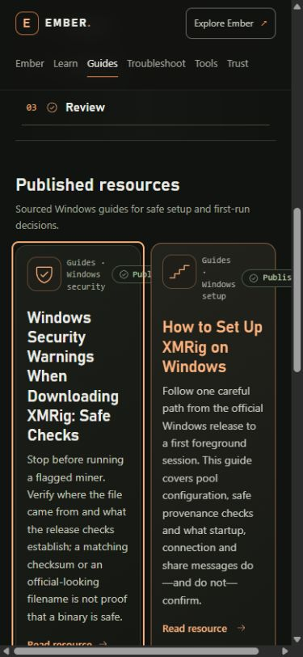
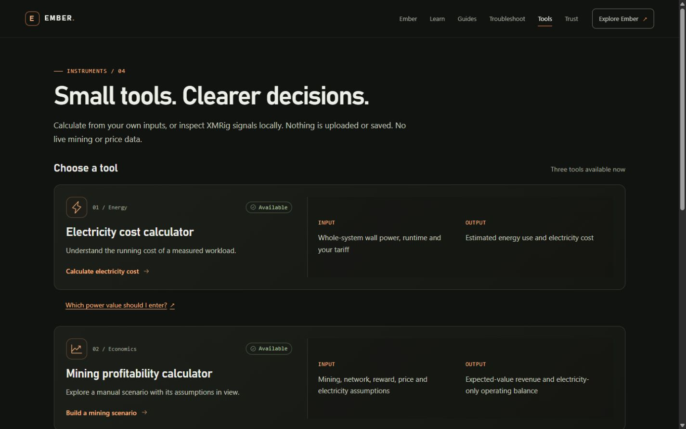

# M12B.1 — Resource-first hubs and contextual discovery

**Completed:** 18 November 2026. **Scope:** `website/` only. **Branch / starting HEAD:** `main` / `f935ed2ee521ee1db882289143d1b13ab9351f72`. The initial working tree was clean, including generated files. No branch, commit, push or deployment was created. M12B.2 has not started.

## Baseline and original problems

Reviewed the four approved M12A reports, [M12B.0 baseline](m12b0-preview-baseline.md), hub components, collection filters, shared navigation/styles and existing tests. The 55 build inputs initially hashed to `a2969abf75f2d3ae362b7e9833f6c08dd31c9b865f328056aa384aaa73a7892a`, exactly matching M12B.0. Its committed screenshots and measurements are therefore valid before evidence despite the newer documentation commit. They were preserved.

The old hubs placed editorial framing and conceptual panels before usable resources. At 1440 × 900, first cards started below the viewport. Guides sorted by publication date rather than task and retained two published-card columns on mobile. UI-01 produced 403px document content within a 375px root client width at 390px, and 388px within 345px at 360px. Available tools used the generic “Read resource” action and shared prominence with planned instruments.

| Hub | M12B.0 first resource top | M12B.1 first resource top |
| --- | ---: | ---: |
| Learn | 962.86px | 386.75px |
| Guides | 951.86px | 386.75px |
| Troubleshoot | 962.86px | 386.75px |
| Tools | 1098.14px | 386.75px |

These are initial-scroll measurements at 1440 × 900 CSS pixels, using the recorded baseline and current browser methods. They demonstrate earlier resource access; they are not traffic, conversion or comprehension measurements.

## Design decisions by hub

### Learn

Two published explanations immediately follow the concise introduction. Each has a distinct category, Phosphor icon and action: memory layers versus cores/logical processors/mining workers. Card descriptions explain the difference without promising an optimal configuration. The existing conceptual strip now supports the resources below them. A specific handoff leads to the standalone Windows setup guide. Beginner, hashrate and pool concepts remain labelled, non-interactive planned topics.

### Guides

The order now follows tasks: first Windows setup, then a flagged-download/security-warning path. The safety card has a restrained warm border, explicit stop/verify copy and “Check the warning safely”; its Published badge describes availability, not file safety. The introduction preserves Ember's development/no-public-download status. A contextual sentence sends failed first-session signals to troubleshooting and keeps unresolved security warnings blocked.

### Troubleshoot

Three symptom choices lead to Huge Pages, MSR and low-hashrate guides. A separate, full-width decoder companion is visibly available and says that it recognizes supported signals, suggests checks and does not establish root causes. The observe → narrow → verify strip follows the chooser. The Windows-security handoff remains a specific text link; the pool-connection topic remains planned.

### Tools

Three instrument rows use the existing lightning, chart and magnifying-glass icons. Each names its purpose and provides semantic Input/Output definitions. The exact actions are **Calculate electricity cost**, **Build a mining scenario**, and **Decode a log**. Desktop composition separates the task/action from its supporting definitions. On narrow layouts the action precedes those definitions in both visual and DOM reading order, keeping the first action visible at 390px and 360px. Each row has a separate, 44px-high link to relevant input/interpretation guidance.

There are no functional mini-tools, numeric results, live-looking indicators or additional scripts. The two planned instruments are compact, non-interactive entries below the available tools. Manual assumptions, expected-value uncertainty and local/no-upload/no-save boundaries remain explicit.

## Shared components and file changes

| File, relative to `website/` | Change |
| --- | --- |
| `src/components/HubPage.astro` | Resources follow the introduction; published collection entries and available manual cards precede conceptual support and planned topics. Supports concise article-card overrides and route-specific handoffs. Draft filtering remains in the existing collection queries. |
| `src/components/ResourceCard.astro` | Typed, optional action labels; standard/tool/companion presentations; optional caution tone and static Input/Output definitions. One full-card anchor, with no nested interactive element. Planned resources render without anchors. |
| `src/pages/learn/index.astro` | Distinct concept descriptions/actions, shorter introduction and setup handoff. |
| `src/pages/guides/index.astro` | Explicit setup/security task ordering, safety copy and troubleshooting handoff. |
| `src/pages/troubleshoot/index.astro` | Symptom ordering/descriptions, prominent decoder companion and security handoff. |
| `src/pages/tools/index.astro` | Three available instrument rows, task actions, guidance links and subordinate future instruments. |
| `src/styles/site.css` | Hub/card composition, wrapping metadata, responsive grids, readable card text, non-geometric hover transitions and guidance-link targets. Changes are confined to hub/resource selectors. |
| `src/pages/tools/monero-mining-profitability-calculator.astro` | Only an `input-sources` ID on the existing input-guidance heading. |
| `src/pages/tools/xmrig-log-decoder.astro` | Only a `decoder-scope` ID on the existing scope heading. |
| `src/content/articles/xmrig-msr-error.md` | A contextual security-warning link at the provenance/blocked-file check. No new technical procedure or review date. |
| `docs/content-roadmap.md` | Records completed M12B.0/M12B.1 work and the bounded next phase. |

`HubVisual.astro` was inspected and retained. Learn/Troubleshoot still use it below resources; Guides/Tools rely on their task/tool composition instead of another generic introductory panel. Existing icons, local fonts, palette, homepage hero, navigation and footer were preserved. No new dependency or reusable abstraction beyond the existing components was introduced.

## Contextual links

| Decision | Implemented destination |
| --- | --- |
| Learn reader ready for a first session | `/guides/xmrig-windows-setup/` |
| Guide reader seeing unexpected first-session signals | `/troubleshoot/` |
| Troubleshooting visitor with output to inspect | Prominent `/tools/xmrig-log-decoder/` companion |
| Windows blocked a download | `/guides/xmrig-windows-security-warnings/` |
| Electricity tool selection: which watts? | `/tools/electricity-cost-calculator/#power-note-title`, an existing heading |
| Profitability selection: where to obtain assumptions? | `/tools/monero-mining-profitability-calculator/#input-sources`, new ID on existing content |
| Decoder selection: what can it establish? | `/tools/xmrig-log-decoder/#decoder-scope`, new ID on existing content |
| MSR provenance check encounters a blocked/flagged file | Existing Windows security-warning guide |

Tool-guidance links are siblings outside the linked cards. No link was nested within a full-card anchor. Existing article-to-tool/setup-to-security links were preserved rather than repeated in generic panels. No routes, placeholder pages, article-layout navigation or tool controllers were added/changed.

## Guides mobile overflow fix — UI-01

The old `.hub-published .hub-grid` selector kept two columns while the generic mobile grid rule lacked an equally specific Guides override. The new shared `hub-resource-grid` has a consistent one-column rule at ≤680px. Metadata can wrap, grid items have `min-width:0`, and badges retain their intrinsic readable width.

At 390px, Guides now has one **335px** grid column, root client/scroll widths **375/375px**. At 360px, it has one **305px** column and root widths **345/345px**. The Published badges stay inside their cards; measured badge client/scroll widths match, and text bounds fit inside each badge. Both task cards remain full-card keyboard links. Planned topics have no focusable controls.

Before and after:




The [complete mobile Guides capture](evidence/m12b1/guides-full-390x844.jpg) shows both published tasks, contextual handoff and subordinate planned topics.

## Verified preview and build identity

Used the M12B.0 host-execution workflow. The restricted command sandbox's loopback limitation was not worked around by changing security or production networking. A fresh, strictly bound native preview runs at **[http://127.0.0.1:4351/tools/](http://127.0.0.1:4351/tools/)**, Node PID **8228**, using:

```powershell
npm run preview -- --host 127.0.0.1 --port 4351 --strictPort
```

The existing synthetic HTTPS metadata origin is `https://ember-m12b0-audit.invalid`; it was never deployed. All **31 served files** matched the final disk hashes, including **17 HTML routes**. The final browser showed `/_astro/SiteLayout.BDNTWXJH.css`, distinct from M12B.0's `SiteLayout.kgp28hEY.css`. The browser was reloaded after rebuilding; startup messages and unchanged canonical origin were not treated as sufficient identity proof.

- Final source aggregate: `f80fe81a97f15e6d094e193bdebdbbcd1fd34c289eca9456fdad39f601b24c3f`.
- Final generated-output aggregate: `3f0b9ec8a5464f33330853f614d2f1d1773d321958f23408f7072e22a7c858c4`.
- [Build identity](evidence/m12b1/build-identity.json) and [HTTP identity](evidence/m12b1/http-identity.json) provide the per-file records. HEAD identifies the starting commit; the source hash identifies the uncommitted implementation.

## Responsive and visual QA

Used the ChatGPT in-app browser with supported viewport overrides. CSS dimensions came from **`innerWidth` / `innerHeight`**, with scrollbar-excluding root width recorded separately. The embedded engine version is not exposed by the supported inspection API; no browser-version or independent-engine claim is invented.

| Requested and verified CSS size | Four modified hubs | Homepage/shared shell and remaining routes | Guides grid |
| --- | --- | --- | --- |
| 1440 × 900 | Reviewed; no document overflow or clipped badges | All 17 routes measured; no document overflow | Two columns |
| 1280 × 800 | Reviewed; no document overflow or clipped badges | All 17 routes measured; no document overflow | Two columns |
| 1024 × 768 | Reviewed; no document overflow or clipped badges | All 17 routes measured; no document overflow | Two columns; metadata may wrap |
| 768 × 900 | Reviewed; no document overflow or clipped badges | All 17 routes measured; no document overflow | Two columns |
| 600 × 800 | Reviewed; no document overflow or clipped badges | All 17 routes measured; no document overflow | One column |
| 390 × 844 | Reviewed; no document overflow or clipped badges | All 17 routes measured; no document overflow | One column; UI-01 resolved |
| 360 × 800 | Reviewed; no document overflow or clipped badges | All 17 routes measured; no document overflow | One column; UI-01 resolved |

The final [render matrix](evidence/m12b1/render-matrix.json) contains **119 cases**, including the required 28 hub/size combinations and seven homepage cases. Every route retained one H1. Shared navigation fit its available width, and footer-link bounds remained inside the viewport. Available/planned ordering, card descriptions, wrapping labels and action spacing were reviewed. Main card descriptions/static outputs are 15px, actions/guidance 14px and card category/status text 12px; the old tiny tool-result text is outside this phase.

The first tool action begins at approximately y=631px at both 390px and 360px, preceding its supporting model. Guidance targets measure 44px high at every tested size. Full-card focus did not alter card dimensions or document position. Hover changes only border/background color; pointer-hover geometry was source-checked rather than emulated.



For comparison, see [the original Tools opening](evidence/m12b0/tools-1440x900.jpg), which contains editorial material before its resources, and [the complete new Tools page](evidence/m12b1/tools-full-1440x900.jpg).

[Screenshot inventory](evidence/m12b1/screenshots.json): **41 JPEGs**, approximately **2.33 MiB**, with file hashes and independently recorded CSS dimensions. Includes all four hubs and homepage at all seven sizes (35), four keyboard-focus captures, and complete Guides/Tools captures. JPEG dimensions may be scaled and are not the source of viewport measurements. The original M12B.0 evidence remains unchanged.

## Keyboard, semantics and link checks

[Interaction evidence](evidence/m12b1/interaction-checks.json) records **28 representative checks**:

- Native Tab reached the first full-card link on each hub, with the visible 2px warm focus ring; native Enter opened the correct resource. Before/after focus bounds were identical on all four hubs.
- All **11 published/available card links** were followed to their expected routes, including both guide tasks, three diagnostics, the decoder companion and all three tools. Navigation completion was explicitly awaited before recording destinations.
- All **six hub handoff/guidance links** reached the expected paths/fragments. The three tool section IDs exist and show the intended guidance. Wrapped inline handoffs were verified with keyboard activation; block cards/shared nav were also pointer-activated.
- The MSR provenance link reached the security guide's existing “Stop before running a flagged miner” summary. Header Tools and footer Learn links worked.
- Planned entries had no anchors, buttons or tabindex controls. No interactive controls were nested inside card anchors. All four hubs rendered without forms or client scripts.

Headings follow H1 → resource/future H2 → card H3. Meaningful input/output information is ordinary definition-list text; icons are decorative and retain the existing hiding behavior. Availability is stated in text, not color alone. Card actions precede supporting tool definitions in DOM order. Existing global reduced-motion rules still override transitions; no animation or fake activity was added.

**Limits:** no dedicated screen-reader, measured contrast, physical touch/device, 200%/400% zoom or OS reduced-motion emulation was performed in this milestone. No WCAG conformance or total-site accessibility acceptance is claimed. The geometry sweep covers initial states; unchanged tool-controller behaviors were not exhaustively rerun in the browser.

## Automated verification and preservation

Final implementation checks:

| Command / check | Result |
| --- | --- |
| `npm test` | **PASS — 29/29** existing tests. |
| `npm run check` | **PASS — 46 files; 0 errors, warnings or hints.** |
| `$env:SITE_URL='https://ember-m12b0-audit.invalid'; npm run check:links` | **PASS — final release-style build and local-link/fragment/content verification; 17 routes.** The script's build was reused; no separate redundant build command was required. |
| `npm run verify:production-origin` | **PASS — all 17 routes**, canonical/OG/schema/social-image/sitemap/robots/slash checks against the synthetic origin. |
| Served-file verification | **PASS — 31/31 exact hash matches** against final output. |
| Browser evidence validation | **PASS — 17 unique routes at each of seven sizes, one H1, no document overflow, no clipped badges/nested controls or linked planned entries.** |
| `git diff --check` | **PASS** after documentation and generated-file cleanup; only LF-to-CRLF notices. |
| Preservation / scope | **PASS — exactly 10 intended build inputs changed; the other 45 and all eight tracked `.astro` files match the baseline.** Earlier milestone reports/evidence are unchanged. |

All eight tracked `.astro` files were snapshotted before tooling and preserved at cleanup. No desktop files, website dependencies/configuration, models, parser rules, controllers, article layouts, homepage hero or product/trust claims changed. The only tool-page changes are two heading IDs. The only article content change is the provenance handoff sentence. No production deployment, DNS, API, account, analytics or tracking work occurred.

Build tooling regenerated `.astro/data-store.json` for the added article link; its saved original bytes were restored after verification. The audit preview metadata and temporary QA helpers were removed. [Preservation evidence](evidence/m12b1/preservation.json) records this cleanup. Final additions are this report and `docs/evidence/m12b1/` (41 JPEGs and seven JSON records); the roadmap and ten source files listed above are the only tracked changes. No generated output is included in the implementation diff.

## Deferred issues and next step

**UI-01 is resolved.** Baseline **UI-02** remains: at 390px, the three tool guidance headings land around y=100px under a 116px sticky header. Their IDs and navigation work; the roughly 16px heading overlap is the previously recorded anchor-clearance issue, explicitly left for the article/navigation phase. It is not marked passed as an unobscured-mobile-anchor check.

Baseline **UI-03** eager profitability validation, **UI-04** stale energy readouts during currency mismatch, **UI-05** decoder font token, and **UI-07** calculator/result typography/composition remain unchanged for their designated phases. UI-06's hub-discovery observations are addressed by this milestone's resource order and task actions; broader article/tool presentation stays outside scope.

There is no remaining blocker to reviewing these hub changes on the verified preview. M12B.2 can later address the bounded article/navigation work and inherited anchor clearance, with its own acceptance checks. **No M12B.2 or M12B.3 implementation was started.**
