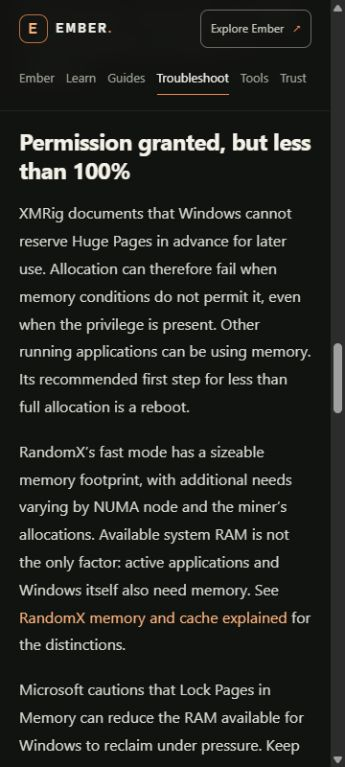
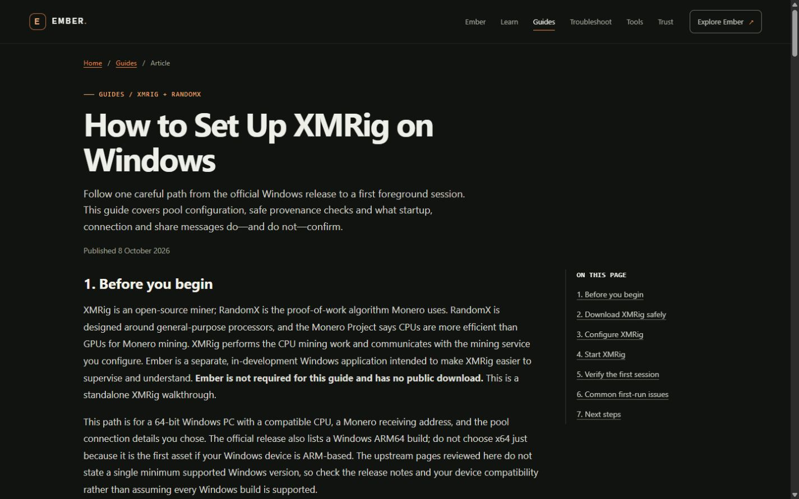

# M12B.2 — Article navigation, technical readability and contextual UX

**Completed:** 22 November 2026. **Scope:** `website/` only. **Starting branch / HEAD:** `main` / `1b0c2ed68bdb27e0d6469495fcbf4d37dd4e7182`. No branch, commit, push or deployment was created. M12B.3 has not started.

## 1. Baseline and preservation

Reviewed the four M12A reports, [M12B.0](m12b0-preview-baseline.md), [M12B.1](m12b1-resource-first-hubs.md), roadmap, shared shell/styles, article loader/layout/visuals, all seven articles and existing link/accessibility/model tests. M12B.1's source changes were already present. The initial working tree contained only:

```text
 M website/.astro/data-store.json
 M website/.astro/dev.json
```

Before tooling, saved the original bytes of all eight tracked `.astro` files. Restored those bytes after final verification; the two original modifications remain. No reset or checkout was used. Earlier milestone reports/evidence, homepage hero, ArticleVisual content/text alternatives, source frontmatter, dependencies, tool controllers, calculations and decoder rules are unchanged. [Preservation evidence](evidence/m12b2/preservation.json) records the comparisons and cleanup.

## 2. Article openings

Removed the repeated “Quick answer” badge and separate introductory callout panels. The breadcrumb now ends with “Article”, avoiding a second copy of the full title. Reduced the oversized title, tightened opening spacing, and displayed Huge Pages' existing `updatedDate` as **Updated**, without calling it a new technical review. Publication dates, technical review/version boundaries and citations retain their original meaning.

| Article | Opening treatment |
| --- | --- |
| Huge Pages | Permission versus allocation summary leads directly to navigation and the existing detailed diagnosis/signal table. Duplicate callout removed. |
| MSR errors | Uses the existing conditional continuation/firmware caveat as the visible deck. The body still defines MSR, explains access boundaries and prohibits arbitrary register/security changes. |
| Low hashrate | Comparable-baseline summary precedes the diagnostic sequence. Removed the repeated baseline callout; pool-estimate and repeatability caveats remain in the explanation. |
| Windows setup | Existing standalone scope and prerequisites remain; checkpoints are reachable directly. Stop/verify warnings still precede configuration and execution. |
| Windows security warnings | “Stop before running a flagged miner” remains visible in the opening. Provenance, unresolved-warning and authorization boundaries are retained. |
| RandomX memory/cache | Existing three-resource summary precedes the quick model; redundant memory callout removed. All sizes, NUMA qualifications and distinctions remain. |
| CPU threads | Existing explanation of Windows logical processors versus useful workers leads into the answer; repeated count callout removed. |

All seven existing diagrams remain, with unchanged labels, captions and alternatives. They now support the explanation after the main body, before Sources, instead of delaying the first section. No diagram pilot or new technical content was introduced. The optional About Ember handoff still explicitly says in development and no public release.

At 390px, the main body starts between **599.58px and 664.78px**; at 360px, between **618.52px and 692.83px**. Every article's first section begins within the requested mobile first screen. These are layout measurements, not comprehension findings.

## 3. Static navigation architecture

The existing collection loader renders Markdown first. `article-experience.mjs` then parses that HTML using the parser/serializer already installed with Astro's Markdown stack (`satteri` / `hast-util-to-html`). No package, configuration change or client script was added.

- Collects actual body H2–H6 elements, including authored HTML headings in both Windows guides. Escaped heading examples inside code are not headings.
- Preserves existing IDs. Missing IDs get deterministic text-derived fragments, avoiding authored IDs, duplicates and reserved shell IDs. Duplicate authored IDs or whitespace-containing IDs fail the build rather than silently changing existing destinations.
- Adds `tabindex="-1"` to section headings so fragment navigation also establishes the keyboard focus position.
- Stores the resulting headings in the rendered entry metadata; `render(entry).headings` drives `ArticleContents.astro`.
- Nests lower-level headings under their nearest preceding higher heading. No invented parent or nonexistent target is added.

There are **41 body sections** across the seven articles. Contents deliberately exclude the supporting diagram, Sources and related-reading headings: those are not body sections. The build verifier parses the generated HTML and checks both contents presentations against the actual body heading order, alongside unique IDs and existing internal-fragment checks.

At **≥1200px**, a subordinate **240px** sticky rail sits beside the maximum **820px** content column with a **48px** gap. It remains in the article grid, so its sticky boundary ends before the footer. The longest rail, eight security-guide entries, measured **389.56px** high at 1280px; when sticky it occupied y=95–484.56px inside the 800px viewport.

Below 1200px, a native `<details>` contents list stays in flow and starts collapsed. Its summary names the purpose and section count; Enter expands it and Tab reaches the links. Expanding uses ordinary document space, with no fixed sidebar, height cap or nested scroll region. CSS hides the alternate presentation, including its keyboard/assistive-technology exposure. There are no duplicated IDs. Links and disclosure work through native HTML without JavaScript; article routes contain zero client scripts.

## 4. Sticky-header anchor fix — UI-02

The old global 100px scroll padding was shorter than the wrapped mobile header. The replacement shares dimensions with the header layout rather than guessing a larger offset:

- Desktop header content: 78px plus its 1px border = **79px**.
- Wrapped header: 44px brand/CTA row + 52px navigation row + responsive row gap + two 8px padding edges + 1px border = **117px**, or **116px** at ≤420px.
- `--header-clearance` is calculated from those same dimensions. Root scroll padding and the desktop rail use that clearance plus a **16px reading gap**.
- The narrow header uses explicit grid rows, keeping the layout and fragment calculation synchronized. Main navigation remains horizontally scrollable when necessary.

Tested one substantive destination per article through **both direct fragment URLs and pointer-clicked contents links** at all five required anchor widths: **70 checks**. Waited 1600ms after navigation, then measured again 120ms later; every second reading was unchanged. Each heading received focus and remained visible.

| Actual CSS viewport | Header bottom | Heading clearance, 14 checks per size |
| --- | ---: | ---: |
| 1440 × 900 | 79px | 15.58–16.44px |
| 1024 × 768 | 79px | 15.50–16.30px |
| 768 × 900 | 117px | 15.52–16.39px |
| 390 × 844 | 116px | 15.67–16.45px |
| 360 × 800 | 116px | 15.72–16.09px |

The separate Huge Pages partial-allocation regression capture at 360px measured heading top **132.42px**, header bottom **116px**, clearance **16.42px**. Six inherited tool-guidance fragment checks at 390px/360px also cleared the header by **15.88–16.36px**. Those tool controllers were not changed.

[All anchor measurements](evidence/m12b2/anchor-checks.json) distinguish direct and clicked navigation. [Interaction evidence](evidence/m12b2/interaction-checks.json) includes the additional regression cases.



## 5. Tables, examples and typography

Audited all seven bodies: **two tables**, in Huge Pages and Windows security, and **five preformatted examples**, all in Windows setup. No technical values or table columns were removed.

Both tables use 15px text, 14px column headers, 14px captions, comfortable cell padding, visible cell boundaries and restrained alternating rows. Column headers have `scope="col"`; the first cell of each body row is a `scope="row"` header. The security comparison receives a meaningful caption and a named, focusable overflow wrapper. The existing Huge Pages caption, named wrapper and scroll instructions remain; it is not wrapped in a second scroll region.

At 390px, both wrappers have a **333px client width**. Huge Pages retains a **960px** table and security a **760px** table, scrolling inside those wrappers. Root client/scroll widths remain **375/375px**. At 360px they remain **345/345px**. No table content is hidden behind clipping or shrunk to fit the document.

Native Tab reached both named regions. Right moved Huge Pages from **0→400px** and security from **0→320px** horizontally, with document scroll X staying **0** and a visible **2px** warm focus outline. Scroll hints explain horizontal access. Physical touch and screen-reader table navigation were not separately tested.

All five code blocks have section-specific accessible names, `tabindex="0"`, local overflow and the existing valid `--mono` token. Block text is **15px**, using **Consolas / Courier New / monospace**; inline code retains the existing relative sizing. Long lines stay preformatted and locally scrollable. Native Tab reached the first PowerShell block, Right scrolled **0→232px**, and subsequent Tab left it for the next source link. Document scroll X stayed 0 and root widths stayed 375/375px. `user-select:auto` remains, with no copy restriction or event interception.

The examples retain their existing context: release-specific PowerShell commands, a non-runnable placeholder JSON configuration, and a foreground startup command. The review did not execute those commands or miner software. No synthetic log, benchmark result or real-observation claim was added. The decoder's separate invalid font token remains deferred.

Body text is **17px / 1.8** on larger layouts and **16px / 1.8** on mobile. Titles, section rhythm, summary spacing, source/date text and underlined links were refined within the existing typography/palette. Diagnostic sequences and signal maps retain their existing distinct treatments. No extra stack of callout boxes was introduced.

**Contrast/text limits:** no fresh measured contrast acceptance is claimed. The unchanged diagram's small 9–12px labels/captions and muted text on composited surfaces remain candidates for dedicated contrast/text-scaling review. Their size is an observation, not a measured WCAG contrast failure.

## 6. Contextual next steps

Existing useful handoffs remain at their decision points instead of being repeated in a generic promotional block:

| Reader decision | Result |
| --- | --- |
| Huge Pages excerpt is incomplete | Existing diagnostic-table decoder link retains bounded supported-signal/unknown-output wording. |
| Full allocation but low performance | Existing table and conclusion lead to the low-hashrate checklist. |
| Windows setup encounters a security block | Existing stop/verify handoff stays before configuration/execution. |
| MSR source/driver provenance is uncertain | M12B.1's existing security link now targets `#check-source`. |
| Useful CPU worker count needs explanation | Existing RandomX memory/cache link retained. |
| Low-hashrate reader needs power measurement guidance | Existing electricity link now targets `#power-note-title`. |
| Low-hashrate reader needs calculator assumptions | Existing profitability link now targets `#input-sources`; expected-value/no-payout caveat retained. |

All seven handoffs were activated and their final routes/fragments verified in the browser. Only the three more precise destinations changed; no duplicate link collection, new content topic or product promotion was added.

## 7. Verified preview and browser matrix

Used the established M12B.0 **host-execution** loopback preview, without changing firewall/security settings. Review surface: [Huge Pages preview](http://127.0.0.1:4352/troubleshoot/xmrig-huge-pages/), native Node PID **34468**, bound to **127.0.0.1:4352**. PIDs identify this run only. Preview remains available for review; stop its owning terminal with Ctrl+C when finished.

```powershell
npm run preview -- --host 127.0.0.1 --port 4352 --strictPort
```

Metadata uses the established synthetic origin **`https://ember-m12b0-audit.invalid`**, not a deployment address. Final [build identity](evidence/m12b2/build-identity.json) records 57 source/public/configuration/manifest inputs and 31 outputs; [HTTP identity](evidence/m12b2/http-identity.json) records **31/31 HTTP 200 and exact disk-hash matches**.

- Source aggregate: `a0379b08bc8ad8979c5a64b8a064345e759d20ccd9fb0eb27a3db7083cf089bc`.
- Output aggregate: `6341eadfc1cba44daacf4de46696f8421cd42bc9f601ed5127f305cf422232f1`.
- Browser stylesheet: `/_astro/SiteLayout.CJO77G46.css`, distinct from M12B.1's `SiteLayout.BDNTWXJH.css`.

The browser reloaded the rebuilt pages. After final automated checks rebuilt again, the entire output was verified byte-identical to the browser-accepted build, and every served file matched again.

| Actual CSS viewport | Article renders | All-route renders | Document overflow | Contents presentation |
| --- | ---: | ---: | --- | --- |
| 1440 × 900 | 7 | 17 | None | Rail |
| 1280 × 800 | 7 | 17 | None | Rail |
| 1024 × 768 | 7 | 17 | None | In-flow native disclosure |
| 768 × 900 | 7 | 17 | None | In-flow native disclosure |
| 600 × 800 | 7 | 17 | None | In-flow native disclosure |
| 390 × 844 | 7 | 17 | None | In-flow native disclosure |
| 360 × 800 | 7 | 17 | None | In-flow native disclosure |

[Render matrix](evidence/m12b2/render-matrix.json): **119 cases**, including **49 article cases**, 35 homepage/hub cases and 35 other-route regressions. Width/height come from `innerWidth/innerHeight`, with root client/scroll widths recorded separately. All pages retained one H1; IDs were unique; every contents target existed. Tables and code stayed contained at every size. Hub resources/order and homepage hero were preserved.

[Screenshot inventory](evidence/m12b2/screenshots.json): **67 JPEGs**, approximately **4.55 MiB**. Includes all seven article openings at all seven sizes, homepage/four hubs at 1440px/390px, and eight representative contents/focus/table/code/anchor/footer states. Representative captures were visually inspected across all seven widths, including every article's mobile opening. The full matrix is rendered geometry/semantics evidence, not a claim of specialist visual or assistive-technology acceptance for every pixel. JPEG dimensions may be scaled; they are not substituted for CSS viewport dimensions.



## 8. Keyboard and accessibility findings

- Native Tab exposed the skip link at y=12px with the 2px focus ring at all five anchor widths. Enter focused `main`; next Tab reached the breadcrumb inside main, skipping the shared header.
- Native Tab/Enter operated the desktop contents and mobile summary/list. Fragment targets received heading focus; native keyboard focus was visible. Pointer/direct navigation does not force a keyboard-style outline.
- The longest rail fit its viewport when sticky. At article end, the rail bottom was y=320.78px and footer top y=701.58px: no overlap. Mobile disclosure overflow was `visible`, not an inner scroll trap.
- Named table/code regions were reachable, scrolled locally, and allowed normal onward Tab navigation. Captions and row/column associations were present in the browser accessibility representation.
- Static-first output, named navigation, link decoration, source links, diagram alternatives and existing reduced-motion rules remain.

[Interaction evidence](evidence/m12b2/interaction-checks.json) contains **27 records**; the separate anchor file contains 70 more. [Browser summary](evidence/m12b2/browser-summary.json) records the aggregate results.

**Limits:** testing used the ChatGPT in-app Chromium-family browser; its engine version was not exposed. No Firefox/WebKit, physical mobile device, dedicated screen-reader session, 200%/400% zoom or fresh measured contrast audit was performed. Native disclosure/semantic inspection does not replace those checks. No WCAG conformance claim is made.

## 9. Exact implementation files and regression results

Paths below are relative to `website/`:

| File | Change |
| --- | --- |
| `src/components/ArticleLayout.astro` | Opening, real update date, reading grid, preserved diagram placement, typography. |
| `src/components/ArticleContents.astro` **new** | Nested static links, desktop rail and native narrow-layout disclosure. |
| `src/components/SiteLayout.astro` | Focusable `main` skip target only. |
| `src/content/article-loader.mjs` | Enhances rendered HTML and stores actual heading metadata. |
| `src/lib/article-experience.mjs` **new** | HTML-tree heading/ID, table and code enhancement; contents hierarchy. |
| `src/styles/site.css` | Shared header dimensions/anchor clearance; readable semantic tables. |
| `src/content/articles/xmrig-msr-error.md` | Existing safety link targets source checks. |
| `src/content/articles/xmrig-low-hashrate.md` | Existing tool links target relevant guidance headings. |
| `scripts/verify-content.mjs` | Parses rendered IDs/body headings; checks seven article contents presentations and duplicate IDs. |
| `tests/article-experience.test.mjs` **new** | Six focused tests: actual/raw/escaped headings, stable/colliding IDs, invalid IDs, hierarchy, table semantics and existing-region preservation. |
| `tests/accessibility-contract.test.mjs` | Existing shell assertion now requires the focusable main target. |
| `docs/content-roadmap.md` | M12B.2 completion and bounded M12B.3 next step. |
| `docs/m12b2-article-experience.md` **new** | This report. |
| `docs/evidence/m12b2/` **new** | 67 JPEGs and eight JSON evidence records. |

| Verification | Final result |
| --- | --- |
| `npm test` | **35/35 pass**: all 29 prior tests plus six article tests. Calculator and decoder tests remain passing. |
| `npm run check` | **49 files**, zero errors, warnings or hints. |
| `SITE_URL=https://ember-m12b0-audit.invalid npm run check:links` | Build **17 routes**; links/fragments, seven complete article contents, unique IDs and sitemap pass. |
| `npm run verify:production-origin`, same environment origin | **17/17 routes**: canonical/OG/schema/social images/sitemap/robots/slashes pass. |
| Final served-build comparison | **31/31** exact matches; final build equals browser-accepted output. |
| Browser matrix / anchors | **119 / 70 cases**, no document overflow, missing contents target, duplicate ID or obscured tested article heading. |
| `git diff --check` | Pass. |
| Preservation | Eight generated files match their initial bytes, including pre-existing dirty state; 49 existing build inputs outside this implementation unchanged. No desktop changes. |

Protected source comparisons use the initially clean Git HEAD, normalizing existing CRLF checkout differences where needed; generated-file preservation compares exact saved starting bytes. Temporary QA helpers/logs and this run's preview metadata were removed after checks. Built output is not included in the implementation diff. No new dependency, API, network service, mining capability, account, tracking or analytics was introduced.

## 10. Remaining limits and M12B.3 preparation

**UI-02 is resolved** for the recorded browser/viewports. No new blocking defect was observed in this scope. UI-03 eager profitability validation, UI-04 stale energy during currency mismatch, UI-05 decoder font token and UI-07 tool/result typography remain assigned to tool work. The separate contrast/text-scaling, assistive-technology and independent-engine/device checks above remain outstanding.

For M12B.3, retain this build/evidence as the baseline; prepare bounded tool-state cases for validation timing/currency recovery/results access and the decoder token correction. Use the existing technical specifications for only the Huge Pages privilege/allocation and profitability revenue-versus-electricity diagram pilots. Preserve the full table, sourced caveats, calculator models and local-processing boundaries. Re-verify the live preview/build identity before that phase. **No M12B.3 implementation was started.**
