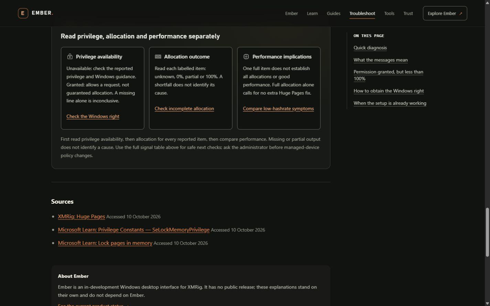
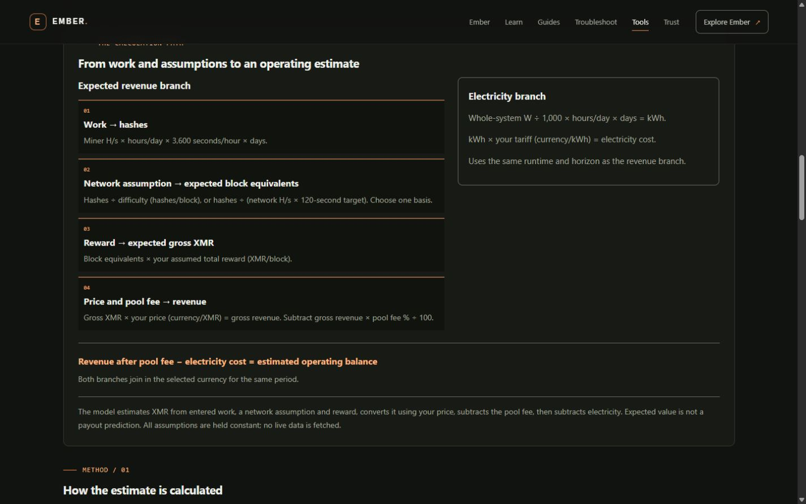
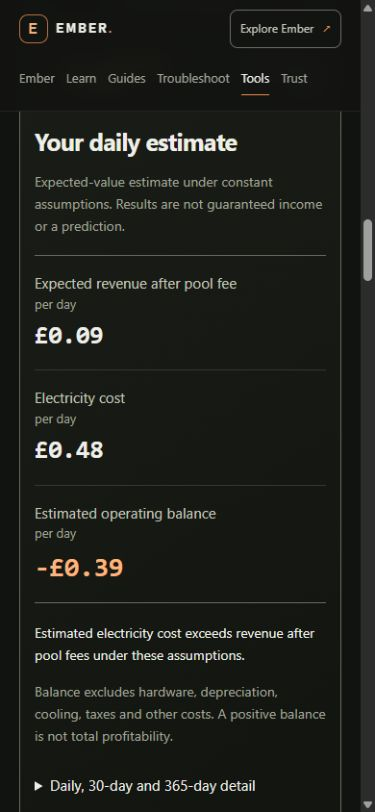

# M12B.3 — Tool UX, results hierarchy and visual explanations

**Completed:** 22 November 2026. **Scope:** `website/` only. **Starting branch / HEAD:** `main` / `fe7e60e25cacbf4de584061a66a22980ad1cc58d`. Initial working tree: **clean**. No branch, commit, push or deployment was created. M12B.4 has not started.

## 1. Baseline and assessment

Reviewed the M12A prioritized plan/visual specifications, M12B.0–M12B.2 reports, roadmap, all three tool pages/styles/controllers, models/parser and tests. Saved exact starting bytes for eight tracked `.astro` files and hashes of all 57 build inputs before tooling. Prior milestones and their evidence were preserved.

| Before | Implemented behavior |
| --- | --- |
| UI-03: typing one hashrate marks seven untouched assumptions invalid | Calculation completeness and error visibility are independent. Untouched fields stay quiet; explicit calculation can reveal missing values. |
| UI-04: pence/USD mismatch returns before refreshing watts and energy | Current valid power, runtime and period always refresh energy. Invalid or incompatible tariffs clear cost only. |
| UI-05: undefined decoder font token falls back to proportional text | Uses existing `--mono`; computed **15px Consolas / Courier New / monospace** at all seven sizes. |
| UI-07: long mobile form before results; approximately 9px projection values | Early results link, explicit calculation/result focus, three readable daily outcomes, secondary locally scrollable **14px** projections. |
| Large introductions delay input/result access | Smaller tool titles and shorter, more compact introductions preserve the existing graphite/orange typography and palette. |

The input form remains long because all required assumptions stay discoverable. The improvement is a one-action path to results and better grouping, rather than hiding required inputs or inventing defaults.

## 2. Validation and confirmed defect fixes

### Profitability — UI-03

The former global `started` flag was replaced by touched-field tracking plus an explicit calculation request. Meaningful input validates the edited field; blur also marks a field touched. Empty or invalid untouched fields still prevent calculation but do not immediately acquire visible errors. Correcting an entry clears its associated error.

**Calculate and view estimate** prevents form submission, reveals missing/invalid assumptions and focuses the first invalid field. A complete valid request focuses the result heading and aligns it below the sticky header. Automatic updates while typing do not move focus. Clear resets values, touched/requested state, errors, the network basis and all result readouts.

Missing or invalid assumptions clear **all three daily outcomes**, projection cells and break-even output. Changing network basis retains exactly one active denominator and clears the inactive value/error. Currency behavior is unchanged: numbers are kept, labels change, and the existing notice explicitly says no conversion was applied.

Visible result status updates immediately. A separate polite announcement is scheduled after blur, change, reset or explicit calculation, not every input keystroke. Existing input descriptions/error associations remain; individual field-error regions remain polite.

### Electricity — UI-04

The controller derives energy with the existing model before checking cost-only conditions. An invalid rate or incompatible pence/currency selection therefore cannot leave old watts, energy or period labels visible. Incompatible tariff state marks the rate invalid, explains the required units and clears all cost horizons. Invalid power/runtime/period clears energy and costs; a blank tariff leaves current energy available and asks for a rate.

Reproduced the original sequence in both event-handler regression tests and the browser at every size:

1. 100 W, 24 hours/day, 20 p/kWh, GBP: **2.4 kWh/day**, **£0.48/day**.
2. Select USD, then enter 200 W: **200 W**, **4.8 kWh/day**, costs **unavailable**.
3. Still incompatible, enter 12 hours/day and 7 days: **2.4 kWh/day**, **16.8 kWh/period**, **7 DAYS**, costs still unavailable.
4. Restore GBP: **£0.48/day**, **£3.36/7 days**, with the rate error cleared.

Choosing `/kWh` instead interprets the unchanged numeric rate in the selected currency; no conversion was added. Invalid-rate, invalid-power, recovery and reset cases were also checked. Visible status and the separate polite announcement follow the same edit-versus-announcement distinction as profitability.

### Decoder — UI-05

Replaced the undefined token throughout the decoder stylesheet with the existing `--mono`. Browser computed typography confirmed 15px monospace at every size. No font package or new token was introduced. The textarea remains selectable, resizable and locally horizontally scrollable with `wrap="off"`.

## 3. Tool layout and result hierarchy

**Electricity:** visible results heading, section links, clearer input/help text, larger daily cost, restrained accent border and readable mobile secondary cost rows. Power, energy and cost retain their units and horizons. The initial 100 W is explicitly illustrative in both input help and result context; nothing implies live hardware detection.

**Profitability:** four semantic fieldsets group miner performance, network assumptions, electricity/runtime and market/pool assumptions. Group notes distinguish measurements from externally sourced or planned assumptions. Existing fields, limits and native radio/select semantics remain. Links reach the input guide, existing calculation, hypothetical worked example, electricity measurement guidance and low-hashrate checklist.

A definition list presents **expected revenue after pool fee per day**, **electricity cost per day**, then **estimated operating balance per day**. Balance has the strongest emphasis. Negative values retain their sign and a plain-language explanation. Expected-value/no-payout and excluded-cost limitations stay visible outside disclosures.

Daily/30-day/365-day detail is a secondary native disclosure. Its semantic table retains all **eight rows and 24 values**, with scoped headers, caption, a named focusable scroll region and scroll instructions. Text is **14px** at all sizes; the table keeps its **660px** minimum width and scrolls locally. Input-source and worked-example tables also received readable text sizes.

**Decoder:** more readable input, metadata, cards and actions; explicit initial empty state; error association through `aria-describedby` and `aria-invalid`; error focus on the textarea. Analysis focuses and aligns its readout only on explicit Analyze. Cards use definition lists for what a signal establishes and its next check, retaining first-occurrence order and existing occurrence counts. “Reported event” avoids presenting a recognized positive event as an overall health verdict.

Unknown-only output still says it does not establish health. Editing analyzed input clears the old cards and requests reanalysis; Clear restores the initial state and input focus. The byte counter now shows the actual byte count, including over-limit input. Processing remains local, with no upload, storage or identifiers echoed into cards.

## 4. Huge Pages visual pilot

Refined the existing Huge Pages branch of `ArticleVisual.astro`, retaining its existing supporting position after the article body. No duplicate diagram or additional introductory panel was added, and the M12B.2 reading/navigation architecture is unchanged.

Three semantic definition groups separate **privilege availability**, **allocation outcome** and **performance implications**. They explain unavailable/granted/missing privilege evidence; per-item unknown/0/partial/100% allocation; and the limits of inferring performance from allocation. Granted privilege does not guarantee allocation, one full item does not establish every allocation, and missing/partial output does not identify a cause. Links use existing Windows-right/allocation sections and the low-hashrate guide. The caption retains the managed-device policy boundary.

Three columns become one vertical sequence on narrow layouts. Full meanings are ordinary text, with the figure's existing heading/description associations. Other six article visuals, Markdown, citations, dates and version caveats are unchanged.

## 5. Profitability calculation visual

Replaced the old five-step figure with two explicit branches joining at operating balance:

- **Revenue:** miner H/s × runtime → hashes → divide by the selected network basis → expected block equivalents → assumed reward → gross XMR → manual price conversion → gross fiat revenue → subtract pool fee.
- **Electricity:** whole-system watts ÷ 1,000 × the same runtime/horizon → kWh → multiply by the entered tariff.
- **Join:** revenue after pool fee minus electricity cost, in the same selected currency and period.

The alternative network-hashrate denominator explicitly uses the existing 120-second target; difficulty and hashrate are not simultaneous denominators. Units and assumptions are labelled. Caption and ordinary text provide an accessible equivalent and say expected value is not a payout prediction. The visual contains no live-looking metrics, sample market price or separate calculation implementation. Existing daily outputs reuse the existing projection object. The hypothetical worked example and its unrounded arithmetic remain.

## 6. Model, parser and scope preservation

[Preservation evidence](evidence/m12b3/preservation.json) compares exact initial/current file hashes. **All three binding implementations are byte-identical:**

- `src/lib/electricity-cost.mjs`
- `src/lib/mining-economics.mjs`
- `src/lib/xmrig-log-decoder.mjs`

This preserves arithmetic, input limits, formatting rules, network-basis rules, the decoder's conservative recognition definitions and 200,000-byte limit. Of 57 initial build inputs, **11 intended presentation/controller inputs changed and 46 remained byte-identical**. All seven article Markdown files, article loader/contents/layout, shared shell/header, homepage hero, dependency/configuration files and product disclosures are unchanged. All eight generated files were restored to their exact starting bytes. No desktop files changed.

No mining functionality, API, account, tracking, analytics, live data, external service or dependency was added. The audit did not execute mining software or download/verify a miner binary.

## 7. Verified preview and responsive QA

Used the M12B.0 host-execution workflow, strictly bound to **127.0.0.1:4353**, native Node PID **31728**. The preview remains available at [the profitability tool](http://127.0.0.1:4353/tools/monero-mining-profitability-calculator/); the retained review tab starts with **zero entered numeric inputs**. PIDs identify this run only. Stop the owning preview terminal with Ctrl+C when finished.

Release-style metadata used **`https://ember-m12b0-audit.invalid`**. This is a synthetic audit origin, not a deployment address. [Build identity](evidence/m12b3/build-identity.json) and [HTTP identity](evidence/m12b3/http-identity.json) record **31/31 HTTP 200 and exact served/disk hash matches**, including all **17 routes**. Browser pages were reloaded after rebuilds. Final browser-observed shared stylesheet: `/_astro/SiteLayout.BtO2ok_A.css`.

- Source aggregate: `d1c9d903c10d18f38a88199ea3dda2820043ebbe74430a4c72c86d6a1fdf7dab`.
- Output aggregate: `4eed6e5399dcc60f436e2a6540644a3b98c7aaddeb405233b5e547b95efeb317`.

| Actual CSS viewport | Initial routes rendered | Tool state sequences | Document overflow | Projection text / decoder input |
| --- | ---: | --- | --- | --- |
| 1440 × 900 | 17 | All three tools | None | 14px / 15px monospace |
| 1280 × 800 | 17 | All three tools | None | 14px / 15px monospace |
| 1024 × 768 | 17 | All three tools | None | 14px / 15px monospace |
| 768 × 900 | 17 | All three tools | None | 14px / 15px monospace |
| 600 × 800 | 17 | All three tools | None | 14px / 15px monospace |
| 390 × 844 | 17 | All three tools | None | 14px / 15px monospace |
| 360 × 800 | 17 | All three tools | None | 14px / 15px monospace |

[Render matrix](evidence/m12b3/render-matrix.json): **119 cases**, including all three tools, Huge Pages and shared-layout routes at every size. Actual dimensions came from `innerWidth/innerHeight`; root client/scroll widths were separately recorded. All retained one H1, with no duplicate IDs or document overflow. Mobile root client/scroll widths were **375/375px** at 390px and **345/345px** at 360px.

[Interaction evidence](evidence/m12b3/interaction-checks.json): **175 records**. The repeated sequence at every size covers electricity defaults/mismatch/new power/new runtime/recovery/invalid/reset; profitability empty/partial/explicit missing/valid negative/projections/invalid/reset; decoder empty/error/unknown-only/long input/edited/clear. Additional cases cover both visual pilots, settled result focus/jumps, keyboard/table access, oversized input and alternative network/currency assumptions.

The explicitly synthetic 7,406-byte decoder fixture produced **225 recognized lines, ten existing signal groups and 26 uninterpreted lines**. It is not an observed mining session. The profitability scenario uses the existing hypothetical worked example: **£0.09 revenue**, **£0.48 electricity**, **−£0.39 operating balance per day** after display rounding. No invented values are prefilled or described as current data.

[Screenshot inventory](evidence/m12b3/screenshots.json): **69 JPEGs**, approximately **3.85 MiB**, with hashes and CSS dimensions. Includes initial tools/Huge Pages at all sizes, results, both pilots, and representative keyboard/validation/table states. Representative images were visually reviewed across desktop/mobile layouts. JPEG resolution may differ from CSS viewport dimensions and was not used as viewport evidence.

## 8. Keyboard, focus and accessibility observations

Native Tab/Enter operated the results jump, projection disclosure/region and decoder actions. The mobile projection region scrolled **0→240px** with Right while document scroll X stayed **0**, retaining a visible **2px** focus outline. Oversized and empty decoder submissions focused the named textarea and its associated error. Editing and clearing removed stale analysis.

After waiting 1600ms for smooth scrolling, explicit Calculate/Analyze actions focused their result headings with these clearances below the shared sticky header:

| CSS width | Calculate clearance | Analyze clearance |
| ---: | ---: | ---: |
| 1440 | 15.50px | 16.31px |
| 1280 | 15.66px | 16.47px |
| 1024 | 16.47px | 15.61px |
| 768 | 15.61px | 16.22px |
| 600 | 15.63px | 16.28px |
| 390 | 15.80px | 15.84px |
| 360 | 15.80px | 15.94px |

Pointer results links also passed at all seven sizes. Article contents remain static, complete and valid; a pilot link reached the existing partial-allocation heading with focus and no header obstruction. Result definitions, captions, scoped table headers, visible negative meaning, fieldsets, input labels and error descriptions are present in rendered semantics.

The existing global reduced-motion rule still sets scrolling to auto and suppresses animation/transition duration. New explicit scrolling uses native `scrollIntoView` without forcing a smooth behavior. **Runtime reduced-motion preference emulation was not performed.**

**Text resizing limit:** two native Ctrl++ shortcuts in the reset 1280×720 in-app browser did not expose a verifiable zoom change; Ctrl+0 was sent afterward. Responsive reflow is verified, but **200%/400% text/zoom acceptance remains outstanding**. No dedicated screen-reader, fresh measured contrast, Firefox/WebKit or physical-device test was performed. Computed semantics and focus checks do not establish complete WCAG compliance.

## 9. Automated verification

| Command/check | Final result |
| --- | --- |
| `npm test` | **44/44 pass**: prior 35 plus eight real-controller event-sequence regressions and one decoder font/semantic contract. Existing arithmetic, parser and article-navigation tests pass. |
| `npm run check` | **50 files**, zero errors, warnings or hints. |
| `SITE_URL=https://ember-m12b0-audit.invalid npm run check:links` | **17 routes**, canonical uniqueness, links/fragments, seven article contents, unique IDs and sitemap pass. |
| `npm run verify:production-origin`, same synthetic origin | **17/17 routes** pass canonical/OG/schema/social-image/sitemap/robots/slash checks. |
| Served output | **31/31** exact matches. |
| Browser geometry and interactions | **119 + 175 records**, zero document overflow observed. |
| `git diff --check` | Pass. |
| Preservation | Models/parser and 46 protected build inputs unchanged; eight generated files match initial bytes; no desktop changes. |

Controller tests execute the production event handlers with the real model functions and a minimal DOM adapter. They cover touched fields, missing estimates, correction, explicit focus, reset/basis/currency behavior, mismatch recovery, stale-readout prevention and announcement timing. No browser-test or other dependency was installed.

## 10. Exact changed files

Paths are relative to `website/`:

| File | Change |
| --- | --- |
| `src/pages/tools/electricity-cost-calculator.astro` | Results heading/context, section links, separate announcement region. |
| `src/pages/tools/monero-mining-profitability-calculator.astro` | Grouped fieldsets, explicit calculation, daily summary, projection disclosure/scroll region, guide links and two-branch figure. |
| `src/pages/tools/xmrig-log-decoder.astro` | Named input error association, local log scrolling and initial empty state. |
| `src/scripts/electricity-calculator.js` | Independent fresh energy/cost validity and controlled announcements. |
| `src/scripts/mining-profitability.js` | Touched/requested validation, current daily readouts, explicit result focus and announcements. |
| `src/scripts/xmrig-log-decoder.js` | Readout states, structured cards, actual byte count, error/focus handling; parser unchanged. |
| `src/styles/electricity-calculator.css` | Scoped input/result hierarchy and mobile cost rows. |
| `src/styles/mining-profitability.css` | Reading sizes, groups, daily outcomes, projections and calculation branches. |
| `src/styles/xmrig-log-decoder.css` | Valid font token, readable log/cards/actions and compact mobile flow. |
| `src/components/ArticleVisual.astro` | Huge Pages pilot only; other visuals retained. |
| `src/styles/site.css` | Huge Pages pilot selectors only. |
| `tests/tool-controllers.test.mjs` **new** | Eight controller regressions. |
| `tests/accessibility-contract.test.mjs` | Announcement/error associations and decoder token contract. |
| `docs/content-roadmap.md` | M12B.3 completion and acceptance next step. |
| `docs/m12b3-tool-ux-visual-explanations.md` **new** | This report. |
| `docs/evidence/m12b3/` **new** | 69 screenshots and seven JSON evidence records. |

Temporary QA helpers/logs and this run's owned preview metadata were removed. Built output is not included in the implementation diff. No desktop, manifest, dependency, model, parser, article Markdown, shared shell/header or homepage source change was made.

## 11. Remaining limitations and M12B.4 recommendations

**UI-03, UI-04 and UI-05 are fixed** in the tested implementation. Projection readability/results access from UI-07 are addressed within this phase. No new blocking functional defect was observed in the recorded browser states.

M12B.4 should perform dedicated screen-reader announcements/table/disclosure testing, measured contrast including focus/error/negative states, verified 200%/400% text resizing, reduced-motion preference testing, independent-engine and physical mobile checks. Review the long-form input/result journey with real users before making broader layout claims. Re-establish preview ownership and build identity before acceptance; retain these event-sequence regressions and the original arithmetic/parser fixtures.

This synthetic-origin audit build is not a public release artifact. Production origin/release acceptance remains a separate authorized step. **No M12B.4 implementation, deployment, commit or push was started.**
