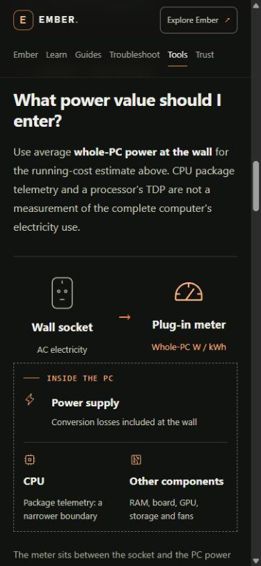
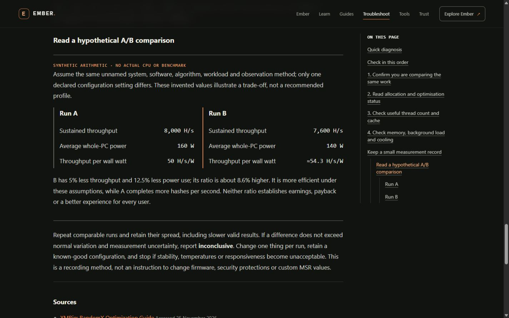
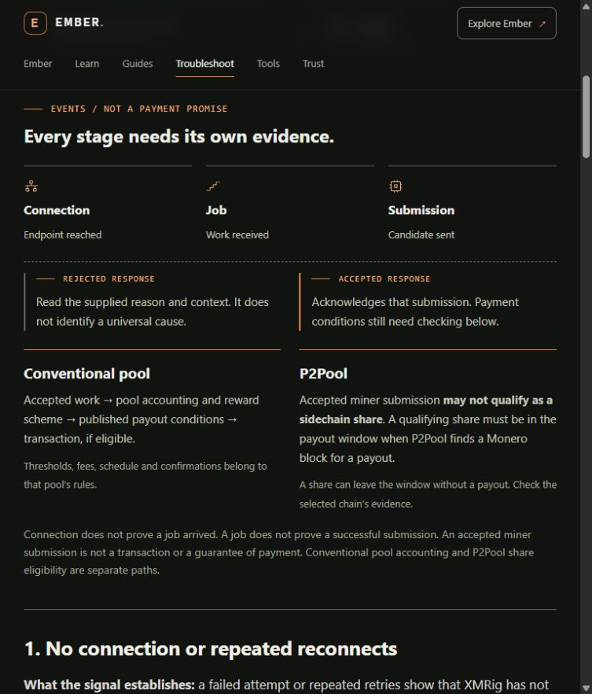

# M13C — Measurement, performance records and pool diagnostics

25 November 2026. **Implemented locally; ready for owner visual acceptance, not deployed.** Scope: `website/` only. B02, B03 and B01 implemented; excluded backlog items remain unstarted.

## Baseline and preserved work

Branch `main`, HEAD `ae9e8061c51b6e7ec13d0df9edb5c59204da13b3`. At entry the central roadmap was modified and six M13B documents were untracked. Those six documents remain byte-identical; the existing roadmap changes are retained with M13C appended. M13A source/controls were preserved. All six M13B reports and the central roadmap informed the bounded scope; their research dates/limitations remain historical evidence.

Inspected the existing route/collection/shared-component structure, including all 17 baseline destinations. Rebuilt with installed Node 24.21.0/Astro 7.3.5, explicit synthetic `SITE_URL=https://ember-m12b0-audit.invalid` and `SITE_INDEXING=noindex`. Used the [M12B.0 host-preview method](m12b0-preview-baseline.md): loopback-only Astro preview in host execution, no administrator launch, firewall/exclusion change, public binding or tunnel. No domain was invented.

The baseline [build manifest](evidence/m13c/before-build.json) records 17 content pages plus the noindex error artifact. Baseline performance independently matched its three measured routes to disk hashes; browser captures verified the five requested baseline pages. Final [build manifest](evidence/m13c/after-build.json) and [HTTP identity](evidence/m13c/after-http.json) match all 34 served content/assets byte-for-byte, including all 18 content pages. Provider `_headers` semantics and live error status are separate from Astro preview delivery and are not claimed verified in production.

## Review the actual preview

The owned local preview is left running at **http://127.0.0.1:4373/**. These are local review URLs, not a public production origin:

- [Electricity calculator and whole-PC method](http://127.0.0.1:4373/tools/electricity-cost-calculator/#power-note-title)
- [Comparable-run worksheet](http://127.0.0.1:4373/troubleshoot/xmrig-low-hashrate/#keep-a-small-measurement-record)
- [Hypothetical A/B comparison](http://127.0.0.1:4373/troubleshoot/xmrig-low-hashrate/#read-a-hypothetical-ab-comparison)
- [New pool/share/payment diagnostic guide](http://127.0.0.1:4373/troubleshoot/xmrig-pool-shares-payments/)
- [Troubleshoot hub](http://127.0.0.1:4373/troubleshoot/)
- [Local decoder](http://127.0.0.1:4373/tools/xmrig-log-decoder/)
- [Windows setup](http://127.0.0.1:4373/guides/xmrig-windows-setup/)

If the local process ends, from `website/` rebuild with the synthetic origin/noindex variables, then run `npm run preview -- --host 127.0.0.1 --port 4373 --strictPort` in an authorized host context. Do not substitute a stale listener or weaken Windows protections. The preview does not need temporary audit scripts/metadata to stay alive.

## Implemented design and content

| Backlog | Actual change | Design / technical boundary |
| --- | --- | --- |
| B02 | Expanded existing measurement note below the unchanged electricity calculator; seven-field reusable record, interval-energy averaging, hypothetical arithmetic, idle/active boundaries and manual tariffs | `PowerMeasurement.astro`: original socket → meter → PSU/components diagram, text-equivalent caption, short workflow and print-friendly record. Calculator remains first; no extra route, input/default/currency/projection/controller/model change. No device recommendation or actual hardware measurements. |
| B03 | Extended existing low-hashrate record to a 13-row A/B sheet; matched conditions, benchmark/sustained distinction, unknown fields, repeatability and hypothetical 8,000/7,600 H/s comparison | `PerformanceContext.astro` replaces the late generic low-hashrate illustration with a compact hardware/configuration/conditions/results model near the opening. Existing ordered checklist retained. Arithmetic independently checked; no interactive efficiency tool, benchmark redistribution or optimization prescription. |
| B01 | One new guide with no connection, connected/no work, rejected response, accepted/no payment, P2Pool eligibility and information-needed anchors | `PoolPaymentFlow.astro`: static symptom selector, staged evidence and distinct conventional-pool/P2Pool branches. Source-scoped synthetic console samples; no payment deadline, confirmed generic rejection cause, exposed API or Ember P2Pool capability claim. |

The four existing hubs remain. Troubleshoot now shows four available guides and the decoder, replacing the planned pool item. Links from setup's session-verification step and the decoder target connection/rejection/payment decisions. Profitability's performance-input help targets the comparison record; threads and low-hashrate content link to the wall-measurement workflow. Existing Huge Pages/MSR handoffs already cover their relevant decisions and were retained without repetitive link grids.

Graphite/orange tokens, system fonts, existing icons, semantic figures/captions and restrained border/column layouts remain. No homepage/hero redesign. Essential educational content, tables, links and examples are static HTML. No new client JavaScript, network feeds, analytics, tracking, upload, persistence, chart library, benchmark request or dependency was added.

## Primary-source mapping

Sources rechecked 25 November 2026. Version-pinned source supports specific output patterns, not a universal root-cause diagnosis. Community M13B questions supplied need only; no user logs/competitor screenshots or benchmark records were reused.

| Content | Sources / what they support |
| --- | --- |
| Connection/job/response separation and console patterns | [XMRig v6.26.0 Network.cpp](https://github.com/xmrig/xmrig/blob/v6.26.0/src/net/Network.cpp); [official pool options](https://xmrig.com/docs/miner/config/pool). Samples use invented endpoint/numbers and are explicitly shortened/synthetic. Pool-specific configuration/payment rules still require the actual provider's documents. |
| P2Pool share/payment distinctions | [Official payout explanation](https://github.com/SChernykh/p2pool#how-payouts-work-in-p2pool) and [official progress/FAQ](https://p2pool.io/). No fixed payout-window duration, address-format recipe or payment deadline is hardcoded. |
| Comparable performance | [XMRig benchmark method](https://xmrig.com/docs/miner/benchmark), [CPU configuration](https://xmrig.com/docs/miner/config/cpu) and [optimization context](https://xmrig.com/docs/miner/randomx-optimization-guide). These support recording conditions; no third-party benchmark data was imported. |
| Power/energy and TDP | [Energy Saving Trust units](https://energysavingtrust.org.uk/energy-jargon-buster); [Intel TDP explanation](https://www.intel.com/content/www/us/en/support/articles/000055611/processors.html). Record/averaging workflow is Ember's method proposal, not a hardware experiment. A US Energy Department page fetch timed out and was not used as supporting evidence. |
| Manual tariff context | [Ofgem unit rates/standing charges](https://www.ofgem.gov.uk/your-energy-supply/your-energy-bill/energy-price-cap-unit-rates-and-standing-charges); applies to its documented GB scope, not a universal UK tariff. No live rate/default copied. |

## Before/after evidence

[Screenshot inventory](evidence/m13c/screenshots.json) records baseline/updated routes and viewport context. Baseline captures cover electricity, low-hashrate, Troubleshoot, decoder and setup at desktop/mobile. Updated captures additionally cover threads, profitability and the new guide. Detail captures show measurement, A/B arithmetic, console containment and payment branches. Screenshots show selected views, not exhaustive full-page acceptance; CSS dimensions and JPEG pixels can differ with scrollbar/capture scaling.

| Review | Before | After |
| --- | --- | --- |
| Measurement detail, desktop | [Existing note](evidence/m13c/before-measurement-detail-1440.jpg) | [Meter boundary and method](evidence/m13c/after-measurement-detail-1440.jpg) |
| Low-hashrate opening | [Existing opening](evidence/m13c/before-low-hashrate-1440.jpg) | [Comparison model](evidence/m13c/after-low-hashrate-1440.jpg) |
| Troubleshoot discovery | [Planned pool item](evidence/m13c/before-troubleshoot-1440.jpg) | [Available guide](evidence/m13c/after-troubleshoot-1440.jpg) |
| Decoder | [Baseline](evidence/m13c/before-decoder-1440.jpg) | [Updated route](evidence/m13c/after-decoder-1440.jpg); contextual handoff is below the workspace |
| Setup | [Baseline](evidence/m13c/before-setup-1440.jpg) | [Updated route](evidence/m13c/after-setup-1440.jpg); handoff is beside session verification |

Representative mobile/detail evidence:







The [320px meter view](evidence/m13c/after-measurement-detail-320.jpg) and [320px console view](evidence/m13c/after-console-detail-320.jpg) provide narrow-width checks; console scrolling is intentionally contained.

## Responsive, accessibility and SEO verification

| Check | Observed result and evidence |
| --- | --- |
| Eight widths × eight affected routes | **64 cases**, at 1440/1280/1024/768/600/390/360/320 CSS pixels: no document horizontal overflow, one H1 each, table/code regions contained. [Geometry and figure records](evidence/m13c/responsive.json). Visual detail checks included desktop, tablet, 390px and 320px. |
| Keyboard | Symptom links show a visible 2px warm focus outline; Enter reached the payment anchor. At 390px target top 132.27px cleared header bottom 116px. Worksheet arrow input moved its local scroll 40px (333px viewport / 650px content), with visible focus. Existing calculator interaction yielded 4.32 kWh/day and £1.08 for synthetic 180 W/24h/£0.25 inputs. [Interaction records](evidence/m13c/interactions.json). |
| Contrast | **54 computed foreground/background/font groups**, all passing their 4.5:1 or large-text 3:1 requirement; minimum observed 7.06:1. Existing palette reused. [Computed contrast](evidence/m13c/contrast.json); not rasterized anti-aliasing or a whole-site accessibility certification. |
| Rendering modes | **43 checks**: three reduced-motion cases, 30 direct-fragment checks at 1440/390/320 under reduced motion, eight JS-disabled cases and two print-style cases; no failures. [Mode evidence](evidence/m13c/rendering-modes.json). Both record sheets have black-on-white print styling; worksheet min-width removed. This checks CSS/DOM, not physical print pagination. |
| Static content / SEO | `check:links` verifies **18** pages, unique titles/descriptions/canonicals, social/schema consistency, resolved local paths/fragments, homepage main-content reachability, draft exclusion, eight article contents/IDs and sitemap parity. New guide uses existing TechArticle/BreadcrumbList conventions and stable anchors; no FAQ markup. |
| Origin/indexing | `verify:production-origin` verifies all 18 pages against the explicitly synthetic noindex origin, including metadata, `_headers`, sitemap/robots, sharing PNG and protected error document. Origin validation implementation unchanged; only expected page count updated. No public indexing claim. |
| Regression commands | `npm test`: **47 passed**. `npm run check`: **0 errors/warnings/hints**. `npm run build`: **18 pages**. `npm run check:links`: passed. `npm run verify:production-origin`: passed. Final `git diff --check`: passed. No extra dependency or model/parser test rewrite. |

Native zoom/text scaling, actual screen-reader use, Firefox/Safari, physical devices, physical print pagination and public hosting/indexing are **not tested**. Owner visual acceptance is still required. Existing M12B acceptance limits remain open; local Chromium checks do not close them.

## Performance and payload

[Baseline observations](evidence/m13c/performance-before.json): 18 navigations, three existing routes × two profiles × three fresh contexts. [Final observations](evidence/m13c/performance-after.json): 24 navigations, adding the new guide. Both used **Edge 158.0.4370.33**, isolated temporary profiles, cache disabled, disk/HTTP identity checks, no interactions and a five-second post-load observation window. Applied the existing M13A harness with only the measured-route list changed; no dependency installed.

Desktop: 1440×900, unthrottled. Mobile lab: 390×844, DPR 1, CPU slowdown 4×, latency 150 ms, download 204,800 B/s, upload 98,304 B/s. This is the [M13A laboratory method](m13a-performance-baseline.md), not a physical phone, field CWV/INP, Lighthouse score/TBT or a traffic outcome.

| Route | Desktop median LCP ms before → after | Mobile-lab median LCP ms before → after | HTML bytes before → after | Total raw CSS before → after | Raw JS before → after | Requests before → after |
| --- | --- | --- | --- | --- | --- | --- |
| Electricity | 124 → 148 | 872 → 1,012 | 13,315 → 22,676 | 61,952 → 70,245 | 5,776 → 5,776 | 6 → 7 |
| Low hashrate | 132 → 144 | 828 → 992 | 21,172 → 27,230 | 62,309 → 70,602 | 0 → 0 | 4 → 5 |
| Decoder | 116 → 208 | 812 → 828 | 7,033 → 7,500 | 59,326 → 59,518 | 6,895 → 6,895 | 5 → 5 |
| New guide | unavailable → 136 | unavailable → 972 | new → 27,760 | new → 70,602 | new → 0 | new → 5 |

Representative second desktop-run total transfer (including response overhead): electricity **22,273 → 27,568 bytes**; low hashrate **20,675 → 24,967**; decoder **19,839 → 20,046**; new guide **24,555**. New `resource-methods` CSS is 8,293 raw / 2,364 transferred bytes; it is loaded by electricity and the shared article layout, including other article routes. Decoder styling adds 192 raw CSS bytes. Existing shared site CSS is unchanged at 53,524 bytes. All four compiled JS asset hashes/bytes are unchanged; no editorial script was introduced.

All observed CLS values were zero except the electricity desktop samples, which reached about **0.000094** both before and after. No failed/external requests or captured runtime errors occurred. No external fonts loaded. The first desktop electricity run was slower in both sets (732 ms before, 1,044 ms after); all samples are retained. Small same-host samples, warm OS/browser caches, scheduling and separate run times prevent causal performance claims. Added static explanation/stylesheet increases payload; the observed medians are not proof of field performance or a statistically measured regression. No broad optimization or repeated run was justified.

## Changed-file inventory and preservation

Authored implementation/report changes (relative to the repository root):

```text
website/src/components/PowerMeasurement.astro                       new
website/src/components/PerformanceContext.astro                     new
website/src/components/PoolPaymentFlow.astro                        new
website/src/components/ArticleLayout.astro
website/src/components/HubPage.astro
website/src/content.config.ts
website/src/content/articles/xmrig-pool-shares-payments.md           new
website/src/content/articles/xmrig-low-hashrate.md
website/src/content/articles/xmrig-cpu-threads.md
website/src/content/articles/xmrig-windows-setup.md
website/src/pages/tools/electricity-cost-calculator.astro
website/src/pages/tools/monero-mining-profitability-calculator.astro
website/src/pages/tools/xmrig-log-decoder.astro
website/src/pages/troubleshoot/index.astro
website/src/styles/resource-methods.css                             new
website/src/styles/xmrig-log-decoder.css
website/scripts/verify-content.mjs
website/scripts/verify-production-origin.mjs
website/docs/content-roadmap.md                                    retains pre-existing M13B work
website/docs/m13c-measurement-performance-diagnostics.md             new
```

Retained screenshots and JSON evidence are listed exactly in [the machine-readable inventory](evidence/m13c/changed-files.json). This distinguishes this milestone's files from the six already-untracked M13B documents. Generated Astro cache changes and owned temporary audit helpers are cleaned up after checks, without discarding prior work.

Calculator math/controllers, all three tool JavaScript bundles, decoder parser/limits, homepage source/animation, dependencies/lockfiles, origin-validation logic and product/privacy disclosures remain unchanged. No desktop file, new navigation section, benchmark ingestion, configuration assistant, B04/B05/B06 implementation, mining experiment, promotion, commit, push or deployment occurred.

## Owner acceptance

Review the power boundary/record, A/B worksheet and six diagnostic states on the local preview, including narrow screens. Confirm the scope/wording and visual presentation before any separately authorized release. Existing host/origin confirmation, native accessibility/device checks and later search-console setup remain owner actions. No unresolved implementation blocker is currently known within the recorded acceptance scope.
