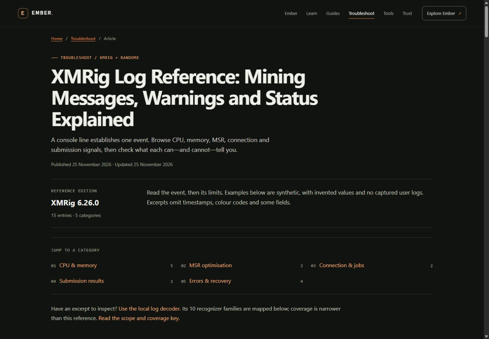
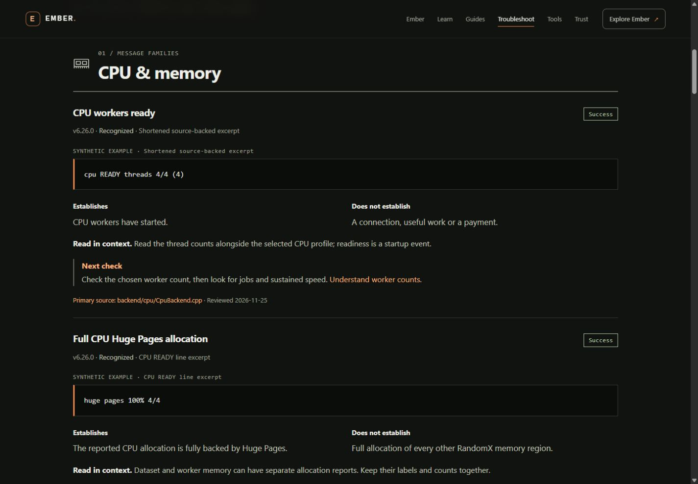
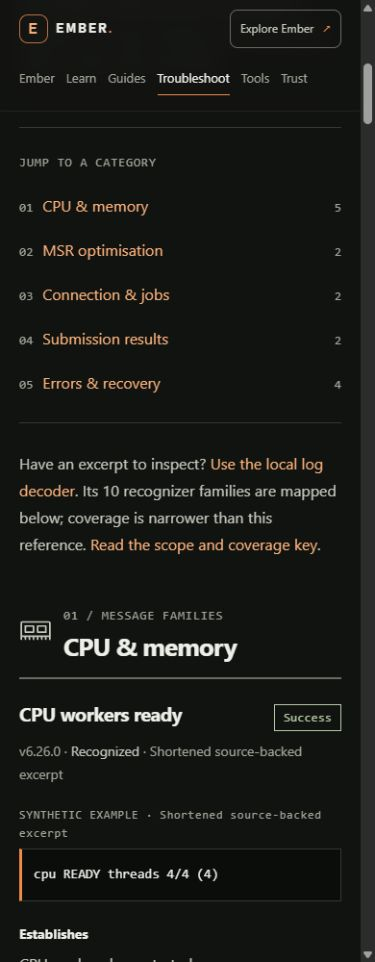
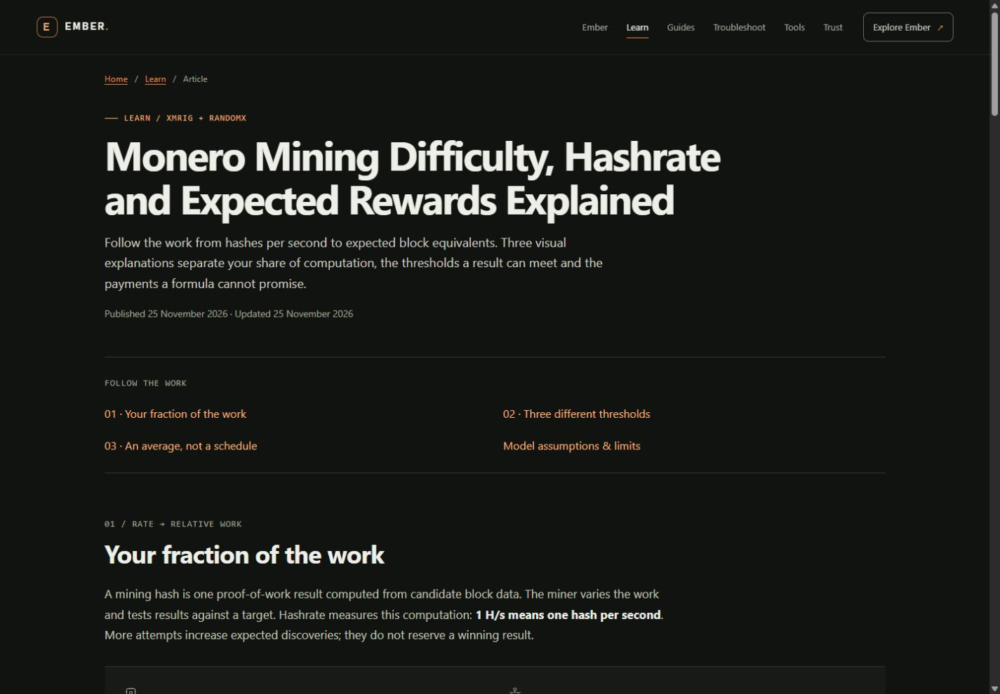
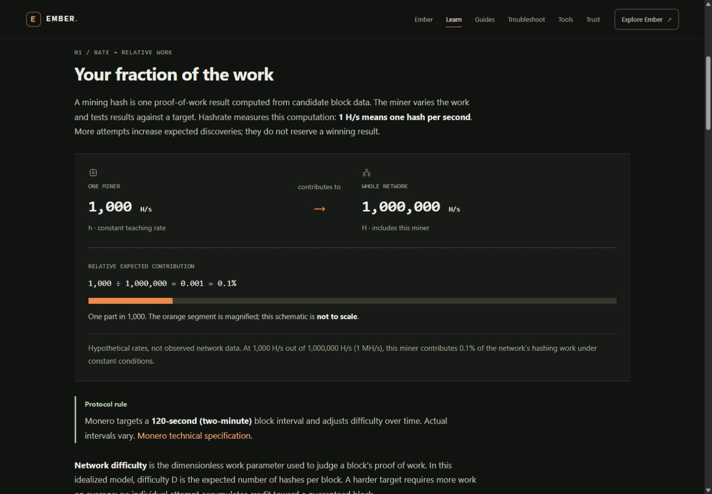
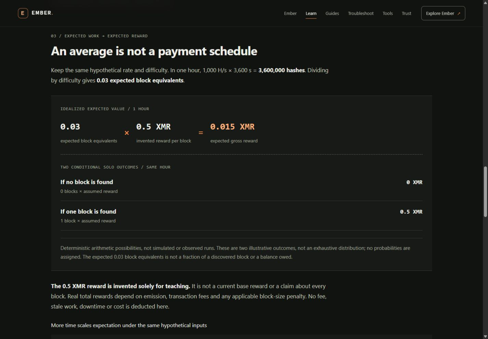

# M13D — Technical reference and visual mining education

25 November 2026. **Implemented locally; ready for owner visual acceptance.** No commit, push, deployment, promotion or mining experiment.

## Baseline and preview identity

Started on clean `main`, HEAD `5b1302eb08de93c8dead07ee06f7933b2d966b98`. Verified 47 baseline tests and an 18-route build. Reviewed the M13B research/roadmap, M13C report, collection/layout, visual tokens/components, decoder and calculator model. Both requested slugs were unoccupied and fit the existing Troubleshoot/Learn collection generators; no new section or message-specific routes.

- [XMRig diagnostic reference](http://127.0.0.1:4374/troubleshoot/xmrig-log-reference/)
- [Difficulty and expected rewards](http://127.0.0.1:4374/learn/mining-difficulty-expected-rewards/)

The owned preview on port 4374 serves this checkout’s final `dist`. [Build audit](evidence/m13d/build-audit.json) verifies SHA-256 identity for all 20 HTML routes and 14 CSS/JS/image assets. An initial sandbox listener was inaccessible to the browser; it was stopped and replaced with an authorized host-context loopback listener. No protection/settings changes. Preview links remain local and depend on that process. To restart: build in `website/` with `SITE_URL=https://ember-m12b0-audit.invalid` and `SITE_INDEXING=noindex`, then `npm run preview -- --host 127.0.0.1 --port 4374 --strictPort`.

## Published resources and integration

**B05:** `XmrigReference.astro` renders structured `xmrig-reference.mjs` data as 15 entries in five anchored categories. Each has a stable ID, version, interpretation boundaries, context, safe next check, related resource, source and coverage label. Thirteen synthetic console excerpts use source-backed wording/format with invented values; two recognizer labels deliberately have no fabricated native example. Text labels distinguish information, success, warning and error. Explanations remain outside focusable console scroll regions. Compact native category links work without scripts; there is no inactive search/filter control.

The finite inventory maps the decoder’s **10 actual families**. Historical research descriptions do not override the inspected implementation. Seven examples are recognized; five entries are reference-only; native MSR-success wording is explicitly wording-limited; disconnect/retry are explicitly heuristic families. In particular, the pinned MSR success output’s verb differs from the existing recognizer. The reference exposes that limitation; parser rules remain unchanged. A warning or accepted submission is never presented as proof of miner failure or payment.

| Entry ID | Category | Decoder coverage |
| --- | --- | --- |
| `cpu-ready` | cpu-memory | Recognized |
| `huge-pages-full` | cpu-memory | Recognized |
| `huge-pages-partial` | cpu-memory | Recognized |
| `dataset-ready` | cpu-memory | Reference-only |
| `speed-summary` | cpu-memory | Reference-only |
| `msr-applied` | msr-optimization | Wording-limited |
| `msr-failed` | msr-optimization | Recognized |
| `pool-connected` | pool-work | Recognized |
| `new-job` | pool-work | Reference-only |
| `share-accepted` | submissions | Recognized |
| `share-rejected` | submissions | Recognized |
| `read-error` | connection-errors | Reference-only |
| `algorithm-error` | connection-errors | Reference-only |
| `disconnect-family` | connection-errors | Heuristic family |
| `retry-family` | connection-errors | Heuristic family |

**B04:** `MiningEducation.astro` supplies three semantic HTML/CSS figures: miner-to-network rate, branching difficulty thresholds, and deterministic expected-versus-conditional-solo outcomes. `mining-education.mjs` holds frozen teaching inputs/scenarios for a later separately scoped control. No controls, simulation, feeds, external charts or new executable JavaScript.

Learn now publishes three explanations; Troubleshoot adds the reference alongside four guides and the decoder. The planned hashrate item is replaced only because the new lesson covers it. Contextual passages link setup/session verification, memory/CPU workers, Huge Pages, MSR, comparable runs, pool/share/payment evidence, decoder scope and calculator network/reward help. The calculator gains a stable network-assumptions anchor. Existing top navigation, homepage hero, technical guidance and three M13C visuals are retained.

## Source and model mapping

All new source review dates are **25 November 2026**. XMRig scope is **6.26.0**, not a latest-version claim. Each reference entry links its exact pinned file/line range. CPU startup/allocation uses `CpuBackend.cpp`; dataset initialization uses `RxBasicStorage.cpp`; speed windows use `Miner.cpp`; MSR uses `RxMsr.cpp`; connection/job/results use `Network.cpp`; error/recovery context uses `Client.cpp`. The two heuristic descriptions come from Ember’s unchanged recognizer, with native client behavior linked separately.

The lesson separates the [Monero protocol target and reward context](https://docs.getmonero.org/technical-specs/), [XMRig job reporting](https://github.com/xmrig/xmrig/blob/v6.26.0/src/net/Network.cpp#L244-L268), [P2Pool payout eligibility](https://github.com/SChernykh/p2pool#how-payouts-work-in-p2pool) and [P2Pool endpoint/progress documentation](https://p2pool.io/). Pool accounting remains provider-specific. Software algorithm support is not evidence of network activation.

Fixed hypothetical inputs: miner **1,000 H/s**, network **1,000,000 H/s**, target **120 s**, difficulty **120,000,000**, invented assumed total reward **0.5 XMR/block**. Relative rate is **0.001 = 0.1%**; the orange segment is explicitly magnified/not to scale. One hour gives 3,600,000 hashes, 0.03 expected block equivalents and 0.015 gross XMR. Two/ten hours give 0.06/0.30 equivalents and 0.03/0.15 XMR. Tests independently compare these constants with both unchanged calculator network bases.

Difficulty is dimensionless; expected hashes per block is the model interpretation. Rates, difficulty and reward stay fixed; useful active hashing is assumed. Actual reward composition/penalties, stale work, downtime, pool/P2Pool accounting, fees and costs are excluded from the teaching gross result. Conditional zero/one-block solo outcomes are arithmetic possibilities, not observations, simulated samples, assigned probabilities or an exhaustive distribution. Expected work is neither a partial discovered block nor money owed.

## Visual and accessibility evidence

| Reference overview | Individual entry |
| --- | --- |
|  |  |

| Mobile category navigation | Difficulty opening |
| --- | --- |
|  |  |

| Relative hashrate | Expected reward |
| --- | --- |
|  |  |

Before/after hub screenshots are included in the exact evidence inventory below. Additional 390px rate/threshold/reward and 320px threshold/reference-entry captures document mobile flow connections and contained console output. No new pages existed for a before comparison. The new heading scroll margin keeps category kickers above their heading clear of the sticky header. Muted text uses existing readable tokens; semantic status labels and explicit text equivalents avoid reliance on colour. Wide expected-work tables retain caption, column/row headers and a focusable scrolling region.

- [Responsive evidence](evidence/m13d/responsive.json): **160** records, all 20 routes at 1440, 1280, 1024, 768, 600, 390, 360 and 320 CSS pixels; one H1 and no document-level overflow throughout. This is CSS resizing, not native zoom or physical-device testing.
- [Anchor evidence](evidence/m13d/anchors.json): **91** direct/clicked category/lesson checks; every target clears the sticky header. Includes all nine destinations at all eight widths and clicked indexes at desktop/mobile.
- [Contrast evidence](evidence/m13d/contrast.json): **46** computed text-treatment groups across the new resources; minimum **7.03:1**, all above their applicable WCAG text threshold. This samples computed opaque foreground/background combinations, not a complete accessibility certification.
- [Keyboard evidence](evidence/m13d/keyboard.json): Tab order, Enter navigation, focused target outline, console ArrowRight (35px) and table ArrowRight (37px) scrolling at 320px. Both scroll regions retain visible 2px focus outlines; explanations remain outside them.
- Static HTML inspection/build contracts verify all entries, category anchors, three figures and lesson arithmetic with **zero executable scripts** on either new page. No-JavaScript usefulness is established by rendered HTML/native anchors, not by claiming a browser JavaScript-disable run. New components introduce no motion; the existing reduced-motion CSS remains intact. Reduced-motion compatibility was checked in source; OS preference emulation was not available through the browser controls.

Native zoom/text scaling, actual screen readers, Firefox/WebKit, physical devices and owner visual acceptance remain unverified owner actions. Browser geometry/semantic checks do not substitute for them.

## SEO, performance and preservation

Both articles use the existing dated collection, canonical/social metadata, TechArticle/Breadcrumb schema, sitemap and hub discovery. Existing 18 routes remain, for **20** total. Internal fragments resolve, IDs are unique and metadata is unique/consistent. The synthetic `.invalid` audit origin remains HTML/header **noindex**; no production domain, indexing or live-host validation is claimed.

Final payloads: reference HTML **38,019 bytes** (8,405 gzip estimate); lesson HTML **21,750 bytes** (6,764 gzip estimate). Each requests **80,498 bytes CSS** across four shared/local files and **0 bytes JavaScript**. New technical CSS is **9,005 bytes** (2,240 gzip estimate), requested only by these two resources. Existing article-layout CSS increases from 8,785 to 9,676 bytes (+891 raw / +78 gzip estimate). Shared site CSS and M13C resource CSS remain byte-identical. Gzip values are offline estimates, not a hosting compression claim; no new timing/CWV/field-performance claim.

The audit records every affected route’s before/after HTML size; hub deltas are +1,093 Learn / +2,531 Troubleshoot, decoder +172, profitability +264; seven contextual article changes are +161–505 bytes. Homepage HTML remains byte-identical. All four compiled calculator/decoder JS assets and source model/parser/controller files remain unchanged. Dependencies, desktop files and M13B/M13C records/components remain preserved. Generated `.astro` build artifacts were restored from the entry snapshot after verification; temporary audit helpers were removed.

Final commands passed: `npm test` (**52/52**, five new focused tests), `npm run check` (**0 errors/warnings/hints**), `npm run build`, `npm run check:links`, `npm run verify:production-origin`, `git diff --check`. New tests cover finite inventory/IDs, source/version/category metadata, actual supported/reference-only behavior (including the MSR mismatch), arithmetic and collection/handoff contracts. The build verifier additionally checks static entry/category anchors and all three figures. No dependencies, uploads, storage, analytics or live network/market integrations were introduced.

## Exact changed-file inventory

Paths below are relative to `website/`. The final machine-readable inventory includes file sizes and SHA-256 values for implementation/evidence files; the report’s own hash is excluded to avoid self-reference.

### Implementation and reports (27 files)

- `docs/content-roadmap.md`
- `docs/m13d-technical-reference-visual-education.md`
- `scripts/verify-content.mjs`
- `scripts/verify-production-origin.mjs`
- `src/components/ArticleLayout.astro`
- `src/components/HubPage.astro`
- `src/components/MiningEducation.astro`
- `src/components/SiteLayout.astro`
- `src/components/XmrigReference.astro`
- `src/content.config.ts`
- `src/content/articles/mining-difficulty-expected-rewards.md`
- `src/content/articles/randomx-memory-cache.md`
- `src/content/articles/xmrig-cpu-threads.md`
- `src/content/articles/xmrig-huge-pages.md`
- `src/content/articles/xmrig-log-reference.md`
- `src/content/articles/xmrig-low-hashrate.md`
- `src/content/articles/xmrig-msr-error.md`
- `src/content/articles/xmrig-pool-shares-payments.md`
- `src/content/articles/xmrig-windows-setup.md`
- `src/data/mining-education.mjs`
- `src/data/xmrig-reference.mjs`
- `src/pages/learn/index.astro`
- `src/pages/tools/monero-mining-profitability-calculator.astro`
- `src/pages/tools/xmrig-log-decoder.astro`
- `src/pages/troubleshoot/index.astro`
- `src/styles/technical-resources.css`
- `tests/technical-resources.test.mjs`

### Evidence (22 files)

- `docs/evidence/m13d/after-learn-1440.jpg`
- `docs/evidence/m13d/after-troubleshoot-1440.jpg`
- `docs/evidence/m13d/anchors.json`
- `docs/evidence/m13d/before-learn-1440.jpg`
- `docs/evidence/m13d/before-troubleshoot-1440.jpg`
- `docs/evidence/m13d/build-audit.json`
- `docs/evidence/m13d/contrast.json`
- `docs/evidence/m13d/difficulty-overview-1440.jpg`
- `docs/evidence/m13d/expected-rewards-1440.jpg`
- `docs/evidence/m13d/expected-rewards-390.jpg`
- `docs/evidence/m13d/files-changed.json`
- `docs/evidence/m13d/keyboard.json`
- `docs/evidence/m13d/reference-entry-1440.jpg`
- `docs/evidence/m13d/reference-entry-320.jpg`
- `docs/evidence/m13d/reference-navigation-390.jpg`
- `docs/evidence/m13d/reference-overview-1440.jpg`
- `docs/evidence/m13d/relative-hashrate-1440.jpg`
- `docs/evidence/m13d/relative-hashrate-390.jpg`
- `docs/evidence/m13d/responsive.json`
- `docs/evidence/m13d/thresholds-1440.jpg`
- `docs/evidence/m13d/thresholds-320.jpg`
- `docs/evidence/m13d/thresholds-390.jpg`

## Remaining boundaries

B04/B05 are implemented locally; B06/B07/B12, benchmark ingestion, mining experiments, P2Pool installation instructions, promotion, release and production indexing remain outside this milestone. Review upstream versions and endpoint-specific behavior before expanding the reference. Stop here for owner visual acceptance.
